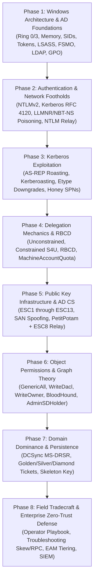

# 🛡️ Active Directory Security, Exploitation & Enterprise Defense Master Curriculum

[](LICENSE)
[](#-master-curriculum-syllabus)
[](#-hands-on-practical-labs)
[](#-how-to-study-this-curriculum)
[](#-active-directory-attack-matrix--telemetry)

An exhaustive, university-grade, and practitioner-focused courseware covering **every single Active Directory vulnerability, protocol mechanism, Windows OS internal, file structure, memory architecture, defense scenario, and field operator error case**.

---

## 📖 How to Study This Curriculum

> [!TIP]
> **Zero Downloads Required**: Every module, lab, and playbook in this curriculum is hosted as a **native GitHub Markdown file (`.md`)**. 
> Click any module or lab link below to read the comprehensive technical documentation directly inside GitHub with full syntax-highlighted code blocks, architecture diagrams, tool flag tables, and detection queries.

---

## 🗺️ Step-by-Step Progressive Learning Pathway



---

## 📚 Master Curriculum Syllabus

| Phase & Module | Module Title | Core Topics & Attack Vectors Covered | Reading Link |
| :--- | :--- | :--- | :--- |
| **Phase 1**<br/>`Module 00` | **Windows Architecture & Low-Level Internals** | Ring 3 User vs Ring 0 Kernel Mode, Virtual Address Space (128TB), PEB/TEB, VAD trees, SIDs, Access Tokens (Primary vs Impersonation), Impersonation Levels, Privileges (`SeDebug`, `SeImpersonate`), Mandatory Integrity Control (MIC), LSASS architecture, SSPI packages (`msv1_0`, `kerberos`, `wdigest`, `cloudap`), NTFS, Alternate Data Streams (ADS / Zone.Identifier), Volume Shadow Copies (VSS), LSA Protection (`RunAsPPL`), and Credential Guard (VBS / Hyper-V). | [Read Module 00](docs/Module-00-Windows-Architecture-and-OS-Internals.md) |
| **Phase 1**<br/>`Module 01` | **Active Directory Architecture & Foundations** | Forest as the sole security boundary, Domain as administrative boundary, Trusts (Parent-Child, Tree-Root, External, Forest, Shortcut), Transitivity, SID Filtering, `ntds.dit` ESE database, PEK and Syskey encryption, 5 FSMO Roles (Schema, Domain Naming, PDCe, RID, Infrastructure), Role seizing via `ntdsutil`, LDAP bitwise filters, `userAccountControl` bitmask flags, SYSVOL architecture, GPO inheritance (LSDO), GPP `cpassword` flaw, ADIDNS record abuse. | [Read Module 01](docs/Module-01-Active-Directory-Architecture-and-Core-Foundations.md) |
| **Phase 2**<br/>`Module 02` | **Authentication Protocols: NTLM vs Kerberos** | NTLMv2 3-way handshake (Type 1, 2, 3), HMAC-MD5 cryptographic formulas, NT hash vs NetNTLM hash, Pass-the-Hash constraints, Kerberos RFC 4120 architecture, AS-REQ/AS-REP, TGS-REQ/TGS-REP, AP-REQ/AP-REP, Privilege Attribute Certificate (PAC) structure, PAC signatures (`PAC_SERVER_CHECKSUM`, `PAC_PRIVSVR_CHECKSUM`), Netlogon validation, Encryption types (`rc4-hmac` 23 vs `aes256` 18), 5-minute clock skew tolerance, Replay Cache. | [Read Module 02](docs/Module-02-Authentication-Protocols-NTLM-and-Kerberos.md) |
| **Phase 2**<br/>`Module 03` | **Network Poisoning & Credential Access** | Hostname resolution fallback order (Hosts -> DNS -> LLMNR -> NBT-NS -> mDNS), Broadcast poisoning mechanics, WPAD auto-discovery hijacking, Responder architecture, flags (`-I`, `-r`, `-d`, `-w`, `-F`, `-v`), `Responder.conf` tuning, Mitm6 IPv6 takeover on IPv4 networks, Hashcat GPU cracking (Mode 5600 NetNTLMv2), John the Ripper, operator troubleshooting, GPO disabling LLMNR/NetBIOS. | [Read Module 03](docs/Module-03-Network-Poisoning-and-Credential-Access.md) |
| **Phase 2**<br/>`Module 04` | **NTLM Relay Attacks & Authentication Coercion** | Cross-protocol relay feasibility matrix (SMB to SMB, SMB to LDAP, SMB to HTTP/ADCS), `impacket-ntlmrelayx` flags (`-t`, `-tf`, `-smb2support`, `-socks`, `-l`, `--escalate-user`, `--delegate-access`, `--adcs`), RPC coercion primitives (PetitPotam MS-EFSR, PrinterBug MS-RPRN, ShadowCoerce MS-FSRVP, DFSCoerce MS-DFSNM, Coercer tool), DC takeover via PetitPotam + ESC8 relay, SMB Signing bypass, EPA and Channel Binding mitigations. | [Read Module 04](docs/Module-04-NTLM-Relay-Attacks-and-Authentication-Coercion.md) |
| **Phase 3**<br/>`Module 05` | **Kerberos Attacks: AS-REP Roasting & Kerberoast** | `DONT_REQ_PREAUTH` UAC flag (`0x400000`), unauthenticated AS-REP harvesting via `GetNPUsers.py`, Hashcat mode 18200, SPN architecture, blind KDC ticket issuance, encryption downgrade to RC4-HMAC, `GetUserSPNs.py`, Rubeus `/tgtdeleg` OPSEC trick, Hashcat mode 13100, Honey SPN traps, Group Managed Service Accounts (gMSA), Event ID 4769 detection. | [Read Module 05](docs/Module-05-Kerberos-Attacks-ASREPRoast-and-Kerberoast.md) |
| **Phase 4**<br/>`Module 06` | **Kerberos Delegation Mechanics & RBCD** | Multi-tier application problem, Unconstrained Delegation (`TRUSTED_FOR_DELEGATION`), TGT caching in LSASS, PrinterBug coercion to unconstrained host, Constrained Delegation (S4U2self and S4U2proxy), Protocol Transition (`TRUSTED_TO_AUTH_FOR_DELEGATION`), `msDS-AllowedToDelegateTo`, `getST.py`, Resource-Based Constrained Delegation (RBCD), `msDS-AllowedToActOnBehalfOfOtherIdentity`, `ms-DS-MachineAccountQuota` default = 10, `addcomputer.py`, `rbcd.py`, Protected Users restrictions. | [Read Module 06](docs/Module-06-Kerberos-Delegation-Mechanisms-and-RBCD.md) |
| **Phase 5**<br/>`Module 07` | **Active Directory Certificate Services (AD CS)** | PKINIT Kerberos authentication (RFC 4556), Complete ESC1-ESC13 taxonomy, ESC1 (Enrollee Supplies SAN), ESC4 (Vulnerable Template DACL), ESC8 (NTLM Relay to Web Enrollment), Certipy command reference (`find`, `req`, `auth`, `ca`, `forge`), Shadow Credentials (`msDS-KeyCredentialLink` via `pywhisker`), Golden Certificates (10-50 year persistence), Strong Certificate Binding (KB5014754). | [Read Module 07](docs/Module-07-Active-Directory-Certificate-Services-ADCS.md) |
| **Phase 6**<br/>`Module 08` | **Active Directory Access Control & ACL Abuse** | Security Descriptors, DACL vs SACL, ACE anatomy, High-impact rights (`GenericAll`, `GenericWrite`, `WriteDacl`, `WriteOwner`, `ForceChangePassword`, `Self-Membership`, `DCSync`), Escalation chains, BloodHound graph theory, SharpHound collection flags, Cypher query reference, `bloodyAD`, `dacledit.py`, AdminSDHolder and SDProp propagation engine, AdminSDHolder backdooring. | [Read Module 08](docs/Module-08-Active-Directory-Access-Control-and-ACL-Abuse.md) |
| **Phase 7**<br/>`Module 09` | **Domain Dominance, Persistence & DCSync** | MS-DRSR protocol replication (`IDL_DRSGetNCChanges`), Extended rights (`DS-Replication-Get-Changes-All`), `secretsdump.py` flags, Golden Ticket generation via `ticketer.py`, Silver Tickets (zero KDC contact), Diamond Tickets (KDC-issued PAC tampering), Sapphire Tickets, Skeleton Key LSASS patch, DSRM network persistence (`DsrmAdminLogonBehavior = 2`), DCShadow (CVE-2018-4088), 2-step `krbtgt` password reset process. | [Read Module 09](docs/Module-09-Domain-Dominance-Persistence-and-DCSync.md) |
| **Phase 8**<br/>`Module 10` | **Field Operator Playbook & Troubleshooting** | Complete command flag reference for Impacket, Rubeus, Mimikatz, and Certipy. Comprehensive Operator Troubleshooting Matrix: `KRB_AP_ERR_SKEW (0x25)`, `KDC_ERR_S_PRINCIPAL_UNKNOWN (0x7)`, `STATUS_LOGON_FAILURE (0xc000006d)`, `STATUS_ACCOUNT_LOCKED_OUT (0xc0000234)`, `STATUS_INVALID_PARAMETER` (SMB Signing), `RPC_S_SERVER_UNAVAILABLE (0x000006ba)`, SOCKS proxying, DNS resolution over proxychains, forcing Kerberos TCP port 88 in `krb5.conf`, `.ccache` to `.kirbi` conversion. | [Read Module 10](docs/Module-10-Field-Operator-Playbook-and-Troubleshooting.md) |
| **Phase 8**<br/>`Module 11` | **Enterprise Zero-Trust Defense & Detection** | Microsoft Enterprise Access Model (EAM), Clean Source Principle, Privileged Access Workstations (PAWs), Protected Users security group restrictions, Hardening GPOs (LLMNR, SMB Signing, LDAP Signing/CBT, LSA Protection RunAsPPL, Credential Guard, Restricted Admin Mode), Master SOC & SIEM Detection Matrix (Event ID 4624, 4768, 4769, 4662, 5136, Sysmon Event 10 LSASS dump). | [Read Module 11](docs/Module-11-Enterprise-Defense-Zero-Trust-and-Detection.md) |
| **Phase 8**<br/>`Module 12` | **Real-World Case Studies & War Stories** | Case 1: The Zero-Click SCF Share Trap in a Global Financial Institution (NetNTLM harvest -> ESC8 relay -> Domain Admin in 14 mins). Case 2: Hospital Ransomware Precursor via Unconstrained Delegation (Legacy PACS server -> SpoolSample DC coercion -> DCSync). Case 3: The noPac DC Spoofing Takeover (CVE-2021-42278 & CVE-2021-42287). Case 4: SolarWinds, Golden SAML & ADFS Cloud-to-Ground Movement. Case 5: Trimarc Security / Sean Metcalf Top 5 Enterprise AD Findings. | [Read Module 12](docs/Module-12-Real-World-Case-Studies-and-War-Stories.md) |

---

## 🧪 Hands-On Practical Labs

Every lab features real-world network topologies, step-by-step terminal execution, genuine command outputs, parameter explanations, troubleshooting sections, and defensive event log verification.

| Lab Exercise | Objective & Practical Tradecraft | Lab Guide |
| :--- | :--- | :--- |
| **Lab 01** | **LLMNR/NBT-NS Poisoning & Hash Cracking**: Execute Responder with WPAD proxy enforcement, capture victim challenge-response hashes, and crack NetNTLMv2 hashes using Hashcat on GPU. | [Open Lab 01](labs/Lab-01-LLMNR-Poisoning-and-Hash-Cracking.md) |
| **Lab 02** | **Kerberoasting & TGS Extraction**: Enumerate high-value SPNs via LDAP, request RC4-HMAC downgraded tickets via `GetUserSPNs.py`, crack service tickets via Hashcat mode 13100, and elevate to Domain Admin. | [Open Lab 02](labs/Lab-02-Kerberoasting-and-TGS-Extraction.md) |
| **Lab 03** | **DCSync & Golden Ticket Dominance**: Execute targeted DCSync using `secretsdump.py` to extract `krbtgt` AES keys, forge a 10-year Golden Ticket with `ticketer.py`, and obtain a SYSTEM shell via WMIExec. | [Open Lab 03](labs/Lab-03-DCSync-and-Domain-Dominance.md) |
| **Lab 04** | **AD CS ESC1 & ESC8 Exploitation**: Audit vulnerable certificate templates via `certipy find`, request an administrator certificate via SAN spoofing (ESC1), coerce DC authentication via PetitPotam, and relay to Web Enrollment (ESC8). | [Open Lab 04](labs/Lab-04-ADCS-ESC1-and-ESC8-Exploitation.md) |
| **Lab 05** | **Resource-Based Constrained Delegation (RBCD)**: Exploit `ms-DS-MachineAccountQuota` to register a machine account, write RBCD security descriptors via `rbcd.py`, and forge S4U2self/S4U2proxy tickets to take over member servers. | [Open Lab 05](labs/Lab-05-Resource-Based-Constrained-Delegation-RBCD.md) |
| **Lab Setup** | **GOAD Homelab Build Guide**: Automated provisioning instructions for the 5-VM Game of Active Directory (GOAD) multi-domain forest on VirtualBox, VMware, or Proxmox. | [Open Setup Guide](labs/Lab-Setup-Guide-GOAD.md) |

---

## 🔬 Active Directory Attack Matrix & Telemetry

```
+-----------------------------------------------------------------------------------------------------------------------+
| ACTIVE DIRECTORY COMPREHENSIVE ATTACK & DEFENSE MATRIX                                                                |
+----------------------+--------------------+--------------------+------------------------------------------------------+
| Attack Technique     | Primary Tool       | Critical Tool Flag | Windows Event ID   | Core Remediation Control        |
+----------------------+--------------------+--------------------+--------------------+---------------------------------+
| LLMNR/NBT-NS Poison  | Responder          | -dwv -F            | Event 4624 (Type 3)| GPO: Turn off multicast name res|
| NTLM Relay (ADCS)    | ntlmrelayx.py      | --adcs --template  | Event 4887         | Enable EPA & Require HTTPS on CA|
| RPC Coercion         | PetitPotam.py      | EfsRpcOpenFileRaw  | Event 4624 (Type 3)| Apply KB5005413 / Disable EFS   |
| AS-REP Roasting      | GetNPUsers.py      | -request -format   | Event 4768 (Pre=0) | Enforce Kerberos Pre-Auth       |
| Kerberoasting        | GetUserSPNs.py     | -request -dc-ip    | Event 4769 (RC4)   | Group Managed Service Accounts  |
| Unconstrained Deleg. | Rubeus.exe         | monitor /interval:5| Event 4769         | Place Admins in Protected Users |
| Constrained S4U      | getST.py           | -spn -impersonate  | Event 4769         | Mark Accounts as NOT_DELEGATED  |
| RBCD Delegation      | rbcd.py / getST.py | -action write      | Event 5136 / 4769  | Set MachineAccountQuota to 0    |
| AD CS ESC1 (SAN)     | certipy            | req -upn admin@... | Event 4887         | Remove ENROLLEE_SUPPLIES_SUBJECT|
| ACL WriteDacl/Owner  | bloodyAD.py        | add genericAll     | Event 5136 / 4670  | Audit Domain DACLs via Cypher   |
| DCSync (MS-DRSR)     | secretsdump.py     | -just-dc-user      | Event 4662         | Restrict Replication Extended R.|
| Golden Ticket        | ticketer.py        | -aesKey -groups    | Event 4672         | 2-Step krbtgt Password Reset    |
| LSASS Memory Dump    | Mimikatz / ProcDump| sekurlsa::logonpwd | Sysmon Event 10    | Enable RunAsPPL & Cred Guard    |
+----------------------+--------------------+--------------------+--------------------+---------------------------------+
```

---

## ⚖️ License & Ethical Tradecraft Contract
This repository and its contents are published strictly for educational, security research, defensive hardening, and authorized penetration testing purposes. Unauthorized testing against systems without explicit, written mutual authorization is illegal. All trademarks belong to their respective owners.
