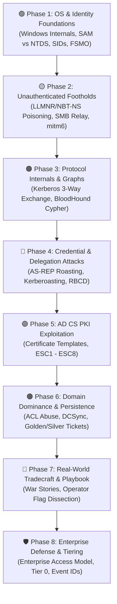

# 🛡️ Active Directory Security & Exploitation: Zero-to-Hero Master Curriculum

> An exhaustive, university-grade courseware, practical operator playbook, and reference textbook covering Windows operating system internals, Kerberos protocol mechanics, BloodHound graph theory, AD CS exploitation, DCSync replication, and zero-trust defensive tiering.

---

## 🗺️ The Step-by-Step Practical Learning Pathway

Follow this sequential 8-phase pathway to progress from zero Windows knowledge to enterprise-grade penetration testing and defensive engineering proficiency.

---

## 🚦 Phase-by-Phase Course Roadmap

| Phase Indicator | Stage Name | Included Modules & Labs | Difficulty | Focus & Core Milestone |
| :---: | :--- | :--- | :---: | :--- |
| **🟢 PHASE 1** | **OS & Identity Foundations** | [**Module 0**](docs/Module-00-Windows-Administration-and-AD-Basics.md) [**Module 1**](docs/Module-01-Architecture-and-Foundations.md) [**Module 9**](docs/Module-09-Windows-Internals-File-and-Memory-Architecture.md) | **Beginner** | Understand the Workgroup vs Domain model, the SAM database vs `ntds.dit`, SIDs, RIDs, User vs Kernel Mode (Ring 3 vs Ring 0), and LSASS memory architecture. |
| **🟡 PHASE 2** | **Initial Footholds & Poisoning** | [**Module 7**](docs/Module-07-TCM-Security-Practical-Methodology.md) [**Lab 1**](labs/Lab-01-LLMNR-Poisoning-and-Hash-Cracking.md) | **Beginner-Int** | Obtain an initial foothold from zero credentials. Master LLMNR/NBT-NS poisoning with Responder, SMB relaying with `ntlmrelayx`, and Hashcat mode 5600. |
| **🟠 PHASE 3** | **Kerberos Internals & Attack Graphs** | [**Module 2**](docs/Module-02-Authentication-and-Kerberos.md) [**Module 3**](docs/Module-03-Enumeration-and-Attack-Graphs.md) | **Intermediate** | Dissect the Kerberos 3-way handshake (AS, TGS, AP exchanges), PAC structure, and map shortest paths to Domain Admin using BloodHound & SharpHound. |
| **🔴 PHASE 4** | **Credential & Delegation Attacks** | [**Module 4**](docs/Module-04-Credential-Attacks-and-Delegation.md) [**Lab 2**](labs/Lab-02-Kerberoasting-and-TGS-Extraction.md) | **Intermediate** | Request and crack service tickets (Kerberoasting), exploit pre-authentication (AS-REP Roasting), and abuse Unconstrained, Constrained, and RBCD delegation. |
| **🟣 PHASE 5** | **AD Certificate Services (AD CS)** | [**Module 5**](docs/Module-05-Privilege-Escalation-and-Domain-Dominance.md) [**Attack Matrix**](docs/Active-Directory-Attack-Matrix-and-References.md) | **Advanced** | Audit Active Directory PKI using Certipy. Weaponize misconfigured certificate templates (ESC1 SAN abuse, ESC4 ACL abuse, ESC8 Web Enrollment NTLM relay). |
| **🟤 PHASE 6** | **PrivEsc, DCSync & Forest Dominance** | [**Module 5**](docs/Module-05-Privilege-Escalation-and-Domain-Dominance.md) [**Lab 3**](labs/Lab-03-DCSync-and-Domain-Dominance.md) | **Advanced** | Exploit directory ACLs (`GenericAll`, `WriteDacl`), simulate DC replication via DCSync (`secretsdump.py`), and forge Golden Tickets using the `krbtgt` key. |
| **🔵 PHASE 7** | **Operator Tradecraft & War Stories** | [**Module 8**](docs/Module-08-Real-World-Case-Studies-and-War-Stories.md) [**Operator Playbook**](docs/Active-Directory-Field-Operator-Playbook.md) | **Expert** | Study real-world enterprise breaches (zero-click SCF share traps, hospital ransomware simulations). Master exact tool flags for Impacket, Rubeus, and Mimikatz. |
| **🛡️ PHASE 8** | **Enterprise Defense & Zero Trust** | [**Module 6**](docs/Module-06-Defensive-Hardening-and-Detection.md) [**Attack Matrix**](docs/Active-Directory-Attack-Matrix-and-References.md) | **Architect** | Implement Microsoft's Enterprise Access Model, Tier 0 isolation, Privileged Access Workstations (PAWs), Protected Users, and SIEM Event ID detection. |

---

## 🔬 Hands-On Practice Labs & Field Artifacts

| Lab Guide | Target Technology | Real-World Console Artifacts Included |
| :--- | :--- | :--- |
| [**Lab 1: LLMNR Poisoning & Cracking**](labs/Lab-01-LLMNR-Poisoning-and-Hash-Cracking.md) | Network Broadcast Abuse | Responder console session, NetNTLMv2 capture, Hashcat benchmark |
| [**Lab 2: Kerberoasting & Service Tickets**](labs/Lab-02-Kerberoasting-and-TGS-Extraction.md) | Kerberos TGS Exploitation | Impacket GetUserSPNs output, ticket structure analysis, Hashcat mode 13100 |
| [**Lab 3: DCSync & Domain Dominance**](labs/Lab-03-DCSync-and-Domain-Dominance.md) | MS-DRSR Replication Protocol | Secretsdump NTDS.dit extraction, Golden Ticket forgery with ticketer |
| [**Homelab Setup: Game of Active Directory**](labs/Lab-Setup-Guide-GOAD.md) | Multi-Domain Forest Lab | Step-by-step Vagrant & VirtualBox deployment of the 5-VM GOAD environment |

---

## 📖 Complete Master Textbooks (PDF Manuals)

This repository includes two publication-grade PDF textbooks compiled with vector typography, embedded architecture diagrams, and formal chapter numbering:
* 📘 **[Active_Directory_Master_Textbook.pdf](Active_Directory_Master_Textbook.pdf)**: 17-Page Comprehensive Enterprise Reference Volume (incorporating all 8 core parts, diagrams, and war stories).
* 📄 **[Active_Directory_Security_Course.pdf](Active_Directory_Security_Course.pdf)**: Companion Quick-Reference Study Manual.
