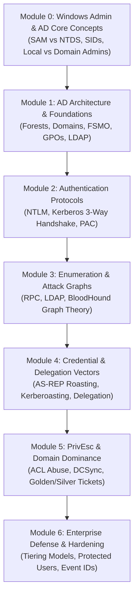

# 🛡️ Active Directory Security & Exploitation: Zero-to-Hero Curriculum

> A comprehensive, structured, module-by-module courseware and reference manual on Active Directory architecture, identity protocols, attack graph mechanics, and enterprise defense tiering.

---

## 📌 Course Philosophy: The "Why Before How" Approach

Active Directory (AD) powers identity and access management for over 90% of Fortune 1000 enterprises. Attempting to learn Active Directory security by memorizing tool commands leads to fragile knowledge. This curriculum is engineered around **first-principles understanding**:

1. **Architecture First**: You cannot break or defend what you do not understand. Learn how Domain Controllers, LDAP, DNS, and Kerberos interact.
2. **Protocol Mechanics**: Understand what happens on the wire during authentication (tickets, PAC, SPNs, session keys).
3. **Graph Theory & Trust Relationships**: Understand that modern AD security is not about vulnerabilities—it is about relationships and unintended permissions (ACLs).
4. **Defense in Parallel**: Every single exposure vector is accompanied by its corresponding detection signature and hardening configuration.

---

## 🗺️ Progressive Learning Roadmap

---

## 📚 Curriculum Breakdown

| Module | Core Topic | What You Learn | Why You Must Learn It |
| :--- | :--- | :--- | :--- |
| [**Module 0**](docs/Module-00-Windows-Administration-and-AD-Basics.md) | **Windows Admin & AD Basics** | Workgroup vs. Domain, SAM file vs. , SIDs, RIDs, and Admin Scopes | Establishes ground-level understanding of Windows identity before attacking it. |
| [**Module 1**](docs/Module-01-Architecture-and-Foundations.md) | **Architecture & Foundations** | Forests, Trees, Domains, FSMO Roles, Global Catalog, LDAP & DNS | Forms the structural skeleton of enterprise Windows networks. |
| [**Module 2**](docs/Module-02-Authentication-and-Kerberos.md) | **Authentication Protocols** | NTLMv2, Kerberos 3-Way Handshake, TGT, TGS, and PAC Validation | Essential for understanding how identity is verified and ticket-based attacks operate. |
| [**Module 3**](docs/Module-03-Enumeration-and-Attack-Graphs.md) | **Enumeration & Graph Theory** | Native queries, PowerView, SharpHound, BloodHound path analysis | Modern assessments rely on finding derivative relationships rather than single exploits. |
| [**Module 4**](docs/Module-04-Credential-Attacks-and-Delegation.md) | **Credentials & Delegation** | AS-REP Roasting, Kerberoasting, Unconstrained & Constrained Delegation | Exploits architectural protocol features rather than software bugs. |
| [**Module 5**](docs/Module-05-Privilege-Escalation-and-Domain-Dominance.md) | **PrivEsc & Dominance** | ACL Abuse (GenericAll/WriteDacl), LAPS, DCSync, Ticket Forgery | Teaches how attackers turn a single domain user into a Domain Administrator. |
| [**Module 6**](docs/Module-06-Defensive-Hardening-and-Detection.md) | **Enterprise Defense & Hardening** | Microsoft Enterprise Access Model, Tier 0 Isolation, Windows Event IDs | Prepares you to architect resilient identity environments and audit security posture. |
| [**Module 7**](docs/Module-07-TCM-Security-Practical-Methodology.md) | **TCM Security & PNPT Practical Flow** | Zero-credential initial footholds, LLMNR/NBT-NS, SMB relay, mitm6, and lateral movement | Real-world black-box internal penetration testing framework. |
| [**Module 8**](docs/Module-08-Real-World-Case-Studies-and-War-Stories.md) | **Red Team War Stories & Case Studies** | SCF zero-click share traps, unconstrained delegation hospital compromise, noPac DC takeover, Trimarc field data | Real-life field experiences from senior penetration testers and red team engagements. |
| [**Attack Matrix**](docs/Active-Directory-Attack-Matrix-and-References.md) | **Master Technique & Reference Matrix** | Complete 6-phase attack lifecycle, syntax (Impacket, Rubeus, BloodHound, Certipy), Event IDs | The ultimate desktop reference mapping all techniques, tools, and detections. |

---

## 🔬 Hands-On Practice Labs & Console Sessions

| Lab Walkthrough | Focus Area | Live Tool Outputs Included |
| :--- | :--- | :--- |
| [**Lab 1: LLMNR Poisoning & Cracking**](labs/Lab-01-LLMNR-Poisoning-and-Hash-Cracking.md) | Network Broadcast Abuse | Responder console output, NetNTLMv2 capture, Hashcat mode 5600 |
| [**Lab 2: Kerberoasting & Service Tickets**](labs/Lab-02-Kerberoasting-and-TGS-Extraction.md) | Kerberos Protocol Exploitation | Impacket GetUserSPNs, TGS structure dissection, Hashcat mode 13100 |
| [**Lab 3: DCSync & Domain Dominance**](labs/Lab-03-DCSync-and-Domain-Dominance.md) | MS-DRSR Replication & Persistence | Secretsdump NTDS.dit extraction, Golden Ticket forgery with ticketer |
| [**Lab Setup: Game of Active Directory**](labs/Lab-Setup-Guide-GOAD.md) | Homelab Deployment | Step-by-step Vagrant & VirtualBox deployment of the 5-VM GOAD forest |

---

## 📖 PDF Guide Export
The companion publication-ready PDF manual is compiled in this repository:
- 📄 **[Active_Directory_Security_Course.pdf](Active_Directory_Security_Course.pdf)**
