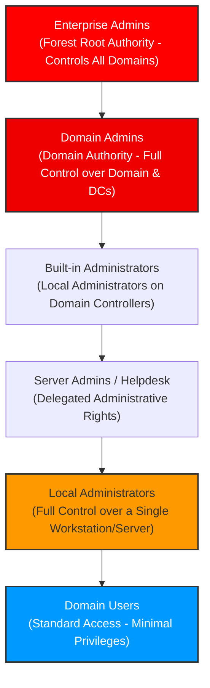
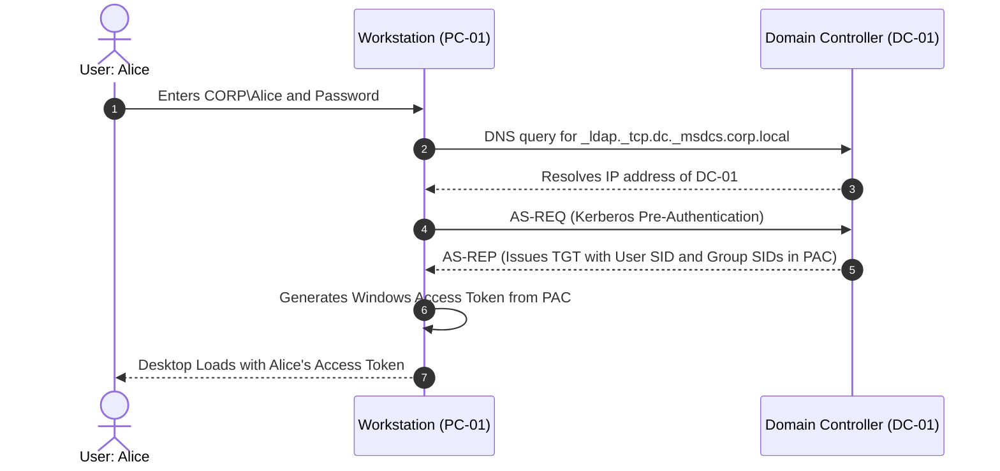

# Module 0: Windows Systems Administration & Active Directory Core Concepts

> **Target Audience**: Beginners and security practitioners transitioning from Linux or web testing to Windows Enterprise environments.  
> **Objective**: Understand how Windows administration works from the ground up—from standalone workstations and local administrators to enterprise-wide Active Directory domains.

---

## 1. What is Active Directory? (The Workgroup vs. Domain Problem)

### 1.1 The Standalone Workgroup Problem
In a standard peer-to-peer home network or small office without Active Directory, computers operate in a **Workgroup**:
* Every single machine maintains its own independent user database called the **SAM (Security Account Manager)** stored locally at `C:\Windows\System32\config\SAM`.
* If a company has 500 computers and hires an employee named Alice:
  * An IT administrator would theoretically have to walk to all 500 machines and manually create the account `Alice` with a local password on every single one.
  * If Alice changes her password, it must be changed on all 500 machines individually.
  * If Alice leaves the company, her account must be deleted from all 500 machines manually.
* This model is completely unscalable for organizations with dozens, hundreds, or thousands of employees.

### 1.2 The Active Directory Solution
**Active Directory Domain Services (AD DS)** is Microsoft’s centralized identity, authentication, and directory service database:
* Instead of storing accounts on individual computers, all user accounts, computer objects, security groups, and policies are stored centrally in a single master database named **`ntds.dit`** hosted on specialized servers called **Domain Controllers (DCs)**.
* When Alice sits at *any* corporate workstation connected to the domain:
  1. The workstation sends an authentication query over the network to a Domain Controller.
  2. The Domain Controller verifies Alice’s password against `ntds.dit`.
  3. The DC issues a Kerberos ticket proving Alice's identity and group memberships.
  4. Alice logs into the workstation without that workstation ever having had an account created for her locally.

---

## 2. Windows Administration: Local Accounts vs. Domain Accounts

To understand Active Directory exploitation, you must clearly distinguish between **Local** identity and **Domain** identity.

| Property | Local Account (`WORKSTATION\Alice`) | Domain Account (`CORP\Alice`) |
| :--- | :--- | :--- |
| **Where it Lives** | In the local machine's `SAM` file | In the Domain Controller's `ntds.dit` database |
| **Where it Authenticates** | Locally on that specific computer only | Centrally via Kerberos or NTLM against a DC |
| **Scope of Authority** | Zero access to other computers by default | Can access network shares, databases, and resources |
| **Identifier Format** | `DESKTOP-ABC\LocalAdmin` | `CORP.LOCAL\DomainUser` |

### 2.1 Security Identifiers (SIDs)
Windows does not track users by their username; it tracks them by an immutable binary string called a **Security Identifier (SID)**:
```
S-1-5-21-3623811015-3361044348-30300820-500
└─┬─┘ └───────────┬───────────┘ └───┬───┘
Prefix     Domain Identifier       RID (Relative ID)
```
* **Well-Known RIDs**:
  * **500**: Built-in Administrator (highest local or domain authority).
  * **501**: Guest account.
  * **502**: `krbtgt` account (the master Kerberos Key Distribution Center account).
  * **512**: Domain Admins group.
  * **513**: Domain Users group.
  * **514**: Domain Guests group.
  * **519**: Enterprise Admins group (forest-wide root authority).

---

## 3. The Administrative Hierarchy: Who Controls What?

Understanding who has authority in Windows networks is vital for both offensive privilege escalation and defensive tiering:



### 3.1 Local Administrator
* Has full control (`NT AUTHORITY\SYSTEM` equivalent) over a **single physical or virtual machine**.
* Can dump passwords from the local memory (LSASS), modify local files, install drivers, and control local services.
* **Crucial Concept**: A Local Administrator on `PC-01` has **zero** control over `PC-02` or the Domain Controller—*unless* credentials belonging to a Domain Admin are left in memory on `PC-01`.

### 3.2 Domain Administrator
* Has full administrative control over the entire Active Directory domain.
* Member of the built-in `Domain Admins` group (RID 512).
* Automatically added to the local `Administrators` group of every domain-joined workstation and server.
* Can remotely execute code, replicate directory secrets (DCSync), modify Group Policies, and create accounts.

### 3.3 Enterprise Administrator
* Exists only in the root domain of an Active Directory **Forest**.
* Has administrative control across *all* child domains and trusts within that forest.

---

## 4. Primary Windows Administrative Consoles & Tools

System administrators manage Active Directory through standardized management consoles (Microsoft Management Consoles - MMC) and PowerShell:

1. **Active Directory Users and Computers (`dsa.msc` / ADUC)**:
   * Create, edit, and organize user accounts, computer objects, and security groups into **Organizational Units (OUs)**.
2. **Group Policy Management Console (`gpmc.msc`)**:
   * Deploy centralized security configurations, registry settings, wallpaper, firewall rules, and startup scripts across thousands of computers simultaneously.
3. **Active Directory Administrative Center (`dsac.exe` / ADAC)**:
   * Modern management interface providing access to the Active Directory Recycle Bin and password settings objects (Fine-Grained Password Policies).
4. **PowerShell `ActiveDirectory` Module**:
   * Built-in administration cmdlets used by sysadmins (and security auditors):
     ```powershell
     # List all domain controllers
     Get-ADDomainController -Filter *

     # Query all enabled users with their email and password last set
     Get-ADUser -Filter 'Enabled -eq $true' -Properties PasswordLastSet, EmailAddress

     # Find all computers running Windows Server
     Get-ADComputer -Filter 'OperatingSystem -like "*Server*"' -Properties OperatingSystem
     ```

---

## 5. Summary: What Happens When a User Logs In?



With this foundational understanding of domains, SIDs, the SAM file vs. `ntds.dit`, and administrative scopes established, you are ready to advance to **Module 1: Architecture & Foundations** to examine forests, trusts, and protocol internals.
