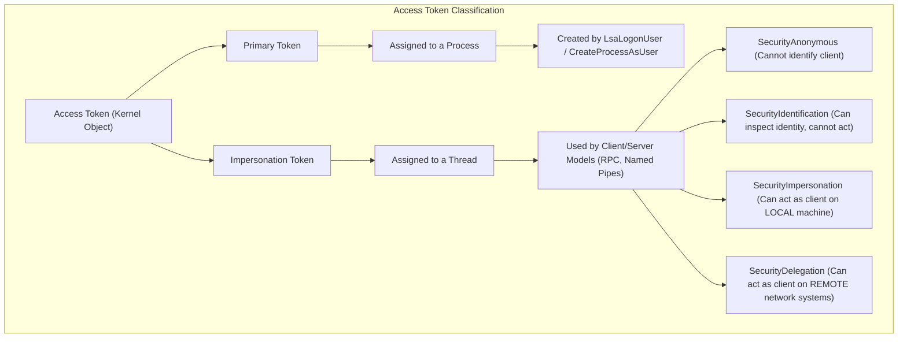
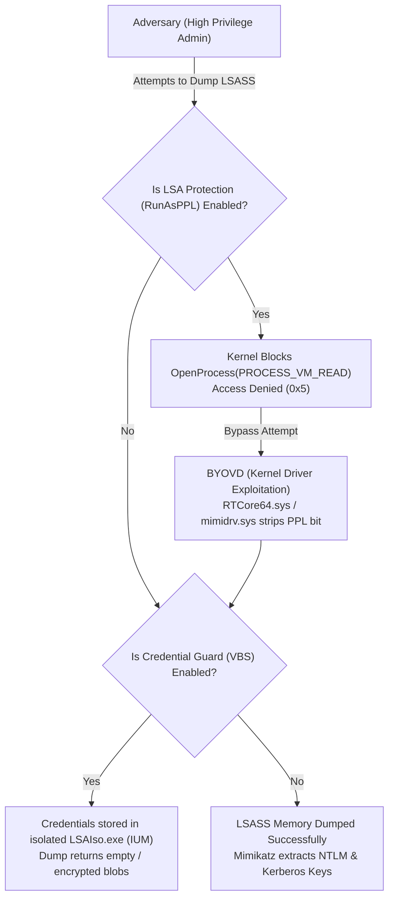

# Module 00: Windows Operating System Architecture & Low-Level Internals

> **Navigation**: [🏠 Master Index](../README.md) | [🏠 Master Index](../README.md) | [Module 01: AD Architecture & Foundations ➡️](Module-01-Active-Directory-Architecture-and-Core-Foundations.md)

---


## 1. Architectural Foundations: Ring 3 User Mode vs. Ring 0 Kernel Mode

At the core of the Windows NT operating system architecture is a strict hardware-enforced separation between unprivileged application space (**User Mode / Ring 3**) and privileged operating system space (**Kernel Mode / Ring 0**). This boundary is enforced directly by the CPU architecture (x86/x64 privilege rings).

```
+-----------------------------------------------------------------------------------+
| USER MODE (Ring 3) - Unprivileged, Isolated Virtual Memory                        |
|                                                                                   |
|  +--------------------+  +--------------------+  +-----------------------------+  |
|  | User Application   |  | PowerShell / CMD   |  | LSASS.EXE (Local Security   |  |
|  | (svchost, explorer)|  | (Adversary Tools)  |  | Authority Subsystem Service)|  |
|  +---------+----------+  +---------+----------+  +--------------+--------------+  |
|            |                       |                            |                 |
|            v                       v                            v                 |
|  +--------------------+  +--------------------+  +-----------------------------+  |
|  | Subsystem DLLs     |  | Subsystem DLLs     |  | Secur32.dll / SSPI DLLs     |  |
|  | (kernel32, user32) |  | (kernel32, advapi32|  | (kerberos.dll, msv1_0.dll)  |  |
|  +---------+----------+  +---------+----------+  +--------------+--------------+  |
|            |                       |                            |                 |
|            +-----------------------+----------------------------+                 |
|                                    |                                              |
|                                    v                                              |
|                      +---------------------------+                                |
|                      |         NTDLL.DLL         |                                |
|                      | (Native System Call Stubs)|                                |
|                      +-------------+-------------+                                |
+------------------------------------|----------------------------------------------+
                                     |  SYSCALL Instruction (Transitions CPU to Ring 0)
=====================================|===============================================
+------------------------------------v----------------------------------------------+
| KERNEL MODE (Ring 0) - Full Hardware Access, Shared Address Space                 |
|                                                                                   |
|  +-----------------------------------------------------------------------------+  |
|  | Executive Services & Kernel (NTOSKRNL.EXE)                                  |  |
|  |  * System Service Dispatcher (KiSystemCall64)                              |  |
|  |  * Process & Thread Manager (EPROCESS / ETHREAD structures)                 |  |
|  |  * Security Reference Monitor (SRM) - Token & Access Validation             |  |
|  |  * Memory Manager (Page Tables, VAD Trees, Virtual Allocations)             |  |
|  |  * Object Manager & Handle Tables                                           |  |
|  +-----------------------------------------------------------------------------+  |
|                                    |                                              |
|  +---------------------------------+-------------------------------------------+  |
|  | Kernel Mode Device Drivers & Filesystem Drivers (NTFS.sys, FLTMGR.sys, etc.) |  |
|  +-----------------------------------------------------------------------------+  |
|  | Hardware Abstraction Layer (HAL.DLL)                                        |  |
|  +-----------------------------------------------------------------------------+  |
|                                    |                                              |
|                                    v                                              |
|                              Physical Hardware (CPU, RAM, Disks, NICs)            |
+-----------------------------------------------------------------------------------+
```

### The Transition Mechanism: How Ring 3 Calls Ring 0
User applications never execute kernel code directly. When a Win32 API function like `OpenProcess()` is invoked:
1. `kernel32.dll` receives the request and forwards it to `KernelBase.dll`.
2. `KernelBase.dll` validates high-level parameters and calls the low-level native API in `ntdll.dll` (e.g., `NtOpenProcess`).
3. `ntdll.dll` loads the **System Service Number (SSN)** into the `EAX` register and issues the CPU-level `syscall` instruction (on x64) or `sysenter` (on x86):
   ```assembly
   mov r10, rcx         ; Save 1st argument in r10
   mov eax, 0x26        ; SSN for NtOpenProcess (varies by Windows build)
   syscall              ; Hardware transition to Ring 0 (KiSystemCall64)
   ret
   ```
4. The CPU switches the Execution Privilege Level to Ring 0, consults the Model Specific Register `MSR_LSTAR` (`0xC0000082`), and jumps directly to `KiSystemCall64` inside `ntoskrnl.exe`.
5. The kernel validates user-mode pointers, looks up the SSN in the **System Service Descriptor Table (SSDT)**, and executes the kernel routine.

> [!NOTE]
> EDRs (Endpoint Detection and Response) place user-mode hooks (inline `JMP` instructions) inside `ntdll.dll` functions. Attackers bypass these hooks by reading the clean `ntdll.dll` from disk or implementing **Direct Syscalls** or **Indirect Syscalls** (jumping directly into the `syscall; ret` instruction gadget inside `ntdll.dll`).

---

## 2. Virtual Memory Architecture & Process Layout

Windows isolates every process within its own private **Virtual Address Space (VAS)**. A process cannot read or write memory belonging to another process unless it holds an explicit handle with `PROCESS_VM_READ` or `PROCESS_VM_WRITE` permissions granted by the Security Reference Monitor.

### Address Space Dimensions
* **32-Bit Windows (x86)**: 4 GB total space. By default, 2 GB is allocated to User Mode (`0x00000000` to `0x7FFFFFFF`) and 2 GB is reserved for Kernel Mode (`0x80000000` to `0xFFFFFFFF`).
* **64-Bit Windows (x64)**: 256 TB theoretical space:
  * **User Mode Space**: 128 TB (`0x00000000'00000000` to `0x00007FFF'FFFFFFFF`).
  * **Non-Canonical Hole**: Invalid address space between user and kernel boundaries.
  * **Kernel Mode Space**: 128 TB (`0xFFFF8000'00000000` to `0xFFFFFFFF'FFFFFFFF`).

```
Virtual Address (x64) Layout:
[0x00000000'00000000 - 0x00007FFF'FFFFFFFF] -> 128 TB User-mode private memory (PEB, TEB, Heap, Stack, Code)
[0x00008000'00000000 - 0xFFFF7FFF'FFFFFFFF] -> Non-canonical address space (Guarded / Trap)
[0xFFFF8000'00000000 - 0xFFFFFFFF'FFFFFFFF] -> 128 TB Kernel-mode space (System Cache, Paged/Non-paged Pool, HAL)
```

### Process Internal Anatomy: PEB, TEB, and VAD
Every running process is represented in kernel space by an `EPROCESS` block, while user mode interacts with the **PEB (Process Environment Block)** and **TEB (Thread Environment Block)**:

1. **TEB (Thread Environment Block)**:
   * Accessible in User Mode via segment register: `FS:[0x18]` (x86) or `GS:[0x30]` (x64).
   * Contains thread-specific data, stack base, stack limit, and a pointer to the process PEB at `GS:[0x60]`.

2. **PEB (Process Environment Block)**:
   * Located at `GS:[0x60]` in 64-bit processes.
   * Key security-sensitive structures inside the PEB:
     * `BeingDebugged` (`PEB + 0x02`): Boolean flag checked by anti-debugging routines.
     * `ImageBaseAddress` (`PEB + 0x10`): Pointer to the base address where the executable is loaded in memory.
     * `ProcessParameters` (`PEB + 0x20`): Contains `CommandLine`, `CurrentDirectory`, and DLL search paths. (Manipulated by malware during process arguments spoofing).
     * `Ldr` (`PEB + 0x18`): Pointer to `PEB_LDR_DATA`, which holds three doubly-linked lists of all DLLs loaded into the process:
       - `InLoadOrderModuleList`
       - `InMemoryOrderModuleList`
       - `InInitializationOrderModuleList`

3. **VAD (Virtual Address Descriptor) Tree**:
   * A self-balancing AVL binary tree in kernel memory that tracks all allocated virtual memory pages inside a process.
   * Each node in the tree specifies the base address, end address, memory protection flags (`PAGE_EXECUTE_READWRITE`, `PAGE_READONLY`, etc.), and whether the memory is backed by a file on disk or committed in the page file.
   * Memory scanners (e.g., Volatility, EDR memory inspection) traverse the VAD tree to detect unbacked executable memory (`PAGE_EXECUTE_READWRITE` pages not associated with any disk DLL, typical of injected shellcode).

---

## 3. Windows Security Identifiers (SIDs) and Access Tokens

Windows implements an object-based access control model overseen by the **Security Reference Monitor (SRM)**.

### Security Identifiers (SIDs)
A SID is a unique variable-length binary structure used to identify a security principal (user, computer, security group, or domain).

**SID Structure Syntax**:
```
S-R-I-S-S-S...
 | | | +-- Sub-authorities (Domain Identifier + Relative Identifier / RID)
 | | +---- Identifier Authority (e.g., 5 = NT Authority)
 | +------ Revision level (always 1)
 +-------- Literal 'S' denoting a SID string
```

#### Critical Well-Known SIDs:
| SID | Identity Name | Security Significance |
| :--- | :--- | :--- |
| `S-1-5-18` | **NT AUTHORITY\SYSTEM** | Highest privilege account in the operating system; complete control over local kernel, memory, and devices. |
| `S-1-5-19` | **NT AUTHORITY\LOCAL SERVICE** | Minimal local privileges; used for unprivileged background services; anonymous network access. |
| `S-1-5-20` | **NT AUTHORITY\NETWORK SERVICE** | Minimal local privileges, but authenticates to network machines using the computer's Active Directory machine account (`COMPUTER$`). |
| `S-1-5-32-544` | **BUILTIN\Administrators** | Local administrator group on workstations, member servers, and Domain Controllers. |
| `S-1-5-21-<Domain>-500` | **Administrator** | The built-in domain/local administrator account. RID `500` is immune to standard account lockout policies. |
| `S-1-5-21-<Domain>-502` | **krbtgt** | Key Distribution Center service account; encrypts all Kerberos Ticket Granting Tickets (TGTs). |
| `S-1-5-21-<Domain>-512` | **Domain Admins** | Full administrative authority over all systems joined to the Active Directory domain. |
| `S-1-5-21-<Domain>-516` | **Domain Controllers** | Machine accounts of all DCs in the domain. |

---

### Access Tokens: Primary vs. Impersonation Tokens
An **Access Token** is a kernel object representing the security context of a process or thread. It contains:
- The User SID for the account.
- Group SIDs (e.g., Domain Admins, Everyone, Authenticated Users).
- User Privileges (e.g., `SeDebugPrivilege`).
- Owner SID and Primary Group SID.
- Default DACL.
- Token Type: **Primary Token** vs. **Impersonation Token**.
- Impersonation Level.



#### The Four Impersonation Levels:
1. **SecurityAnonymous**: The server cannot obtain identification information about the client and cannot impersonate the client.
2. **SecurityIdentification**: The server can obtain identity information (SIDs, privileges) for access checks, but **cannot** impersonate the client to access securable objects.
3. **SecurityImpersonation**: The server can impersonate the client's security context on the **local system**. (Targeted by potato exploits like RottenPotato, SweetPotato, and PrintSpoofer).
4. **SecurityDelegation**: The server can impersonate the client's security context on **both local and remote network systems**. (Requires Kerberos Unconstrained Delegation or RBCD).

---

### Security Privileges & Weaponization Analysis
Privileges determine what system-wide operations a token can perform, regardless of object DACLs:

```
+-------------------------------+-------------------------------------------------------------------------+
| Privilege Name                | Operational Exploitation Mechanism                                      |
+-------------------------------+-------------------------------------------------------------------------+
| SeDebugPrivilege              | Allows attaching to and opening ANY process on the system with          |
|                               | PROCESS_ALL_ACCESS. Bypasses DACLs on LSASS.exe to read memory and dump |
|                               | NTLM hashes / Kerberos tickets.                                         |
+-------------------------------+-------------------------------------------------------------------------+
| SeImpersonatePrivilege        | Allows a service thread to impersonate any client token that connects   |
|                               | to an RPC server or named pipe. Exploited by PrintSpoofer / JuicyPotato |
|                               | to elevate from IIS / MSSQL service accounts directly to SYSTEM.        |
+-------------------------------+-------------------------------------------------------------------------+
| SeAssignPrimaryTokenPrivilege | Allows attaching a newly created primary token to a newly spawned       |
|                               | process via CreateProcessAsUser().                                      |
+-------------------------------+-------------------------------------------------------------------------+
| SeBackupPrivilege             | Grants read access to ALL files on the filesystem, ignoring all file    |
|                               | DACLs. Allows directly copying locked files (NTDS.dit, SAM, SYSTEM).    |
+-------------------------------+-------------------------------------------------------------------------+
| SeRestorePrivilege            | Grants write access to ALL files and registry keys on the system,       |
|                               | ignoring DACLs. Allows overwriting DLLs, services, or registry values.  |
+-------------------------------+-------------------------------------------------------------------------+
| SeTakeOwnershipPrivilege      | Allows taking ownership of any securable object, granting the owner     |
|                               | the right to rewrite the DACL and award themselves full control.        |
+-------------------------------+-------------------------------------------------------------------------+
| SeLoadDriverPrivilege         | Allows loading arbitrary kernel-mode device drivers (.sys). Exploited   |
|                               | in BYOVD (Bring Your Own Vulnerable Driver) attacks to disable EDR.     |
+-------------------------------+-------------------------------------------------------------------------+
```

---

## 4. Mandatory Integrity Control (MIC)

Windows implements **Mandatory Integrity Control (MIC)** to limit the execution permissions of applications running within the same user session:

```
Low Integrity (Sandbox, Edge) < Medium Integrity (Standard User) < High Integrity (Elevated Admin) < System (Kernel/Services)
```

### MIC Rules:
1. **No-Write-Up**: A process with a lower integrity level cannot write to, inject into, or terminate a process with a higher integrity level (prevents a standard user process from modifying an elevated administrative process).
2. **No-Read-Up**: A lower integrity process cannot read securable objects with a higher integrity requirement if the object's SACL explicitly mandates an integrity check.

> [!IMPORTANT]
> When an administrative user opens a standard command prompt, it runs at **Medium Integrity**. To access privileged APIs or dump LSASS, the process must be elevated via UAC (User Account Control) to run at **High Integrity**, which activates the administrative token groups and privileges (`SeDebugPrivilege`).

---

## 5. LSASS Architecture & Security Support Providers (SSPs)

The **Local Security Authority Subsystem Service (`lsass.exe`)** is a critical user-mode system process running as `NT AUTHORITY\SYSTEM`. It is responsible for:
- Enforcing local security policy.
- Authenticating users to the local system and the Active Directory domain.
- Creating and managing user access tokens.
- Handling password changes.
- Loading **Security Support Providers (SSPs)** via the **Security Support Provider Interface (SSPI)**.

```
+-----------------------------------------------------------------------------+
| LSASS.EXE (Local Security Authority Subsystem Service)                      |
|                                                                             |
|  +-----------------------------------------------------------------------+  |
|  | LSASRV.DLL (Core LSA Server - Manages Policies, Sessions, Tokens)     |  |
|  +-----------------------------------------------------------------------+  |
|                                     |                                       |
|  +----------------------------------+------------------------------------+  |
|  | Security Support Provider Interface (SSPI)                             |  |
|  +-----------------------------------------------------------------------+  |
|         |                  |                 |               |               |
|         v                  v                 v               v               |
|  +--------------+  +---------------+  +--------------+  +-----------------+  |
|  | MSV1_0.DLL   |  | KERBEROS.DLL  |  | WDIGEST.DLL  |  | CLOUDAP.DLL     |  |
|  | (NTLM Auth,  |  | (Ticket Cache,|  | (Digest Auth,|  | (Azure AD /     |  |
|  | SAM Hashes)  |  | Session Keys) |  | Plaintext*)  |  | Entra ID Tokens)|  |
|  +--------------+  +---------------+  +--------------+  +-----------------+  |
|         |                  |                 |               |               |
|         v                  v                 v               v               |
|  +--------------+  +---------------+  +--------------+  +-----------------+  |
|  | TSPKG.DLL    |  | CREDSSP.DLL   |  | SCHANNEL.DLL |  | LIVESSPE.DLL    |  |
|  | (Terminal    |  | (RDP Creds,   |  | (TLS / SSL   |  | (Microsoft      |  |
|  | Services)    |  | CredSSP Auth) |  | Handshakes)  |  | Account Tokens) |  |
|  +--------------+  +---------------+  +--------------+  +-----------------+  |
+-----------------------------------------------------------------------------+
```

### Why Adversaries Target LSASS:
When a user logs on interactively or via RDP, the relevant SSPs must cache the credentials in memory to facilitate Single Sign-On (SSO) to network resources:
- `msv1_0.dll` stores the user's **NTLM hash** (used for Pass-the-Hash).
- `kerberos.dll` stores the user's **Kerberos Ticket Granting Tickets (TGTs)** and session keys (used for Pass-the-Ticket).
- `wdigest.dll` historically stored **plaintext passwords** in memory (disabled by default in Windows 8.1 / Server 2012 R2, but can be re-enabled by modifying `HKLM\SYSTEM\CurrentControlSet\Control\SecurityProviders\WDigest\UseLogonCredential = 1`).
- `cloudap.dll` stores **Primary Refresh Tokens (PRTs)** for Entra ID / Microsoft 365 cloud authentication.

---

## 6. Windows Filesystem Internals: NTFS, Alternate Data Streams, and Volume Shadow Copies

### NTFS Architecture & Master File Table (MFT)
The New Technology File System (NTFS) formats storage using a relational database concept. Everything on an NTFS volume is a file, including the filesystem metadata itself:
- `$MFT` (Master File Table): Contains fixed-size 1024-byte records for every file and folder on the volume.
- `$LogFile`: Journal logging filesystem transactions for recovery.
- `$Bitmap`: Tracks cluster allocation.

#### MFT Record Attributes:
Every file record contains attribute headers:
- `0x10 - $STANDARD_INFORMATION`: Timestamps (MACB: Modified, Accessed, Created, MFT-modified), file attributes (Hidden, Read-Only, System).
- `0x30 - $FILE_NAME`: UTF-16 file name, parent directory record index.
- `0x80 - $DATA`: The actual content of the file. If small (< 700 bytes), it is stored directly inside the MFT record (**Resident Data**). If larger, it points to clusters on the disk (**Non-Resident Data**).

### Alternate Data Streams (ADS)
NTFS allows multiple data streams to be attached to a single file name. The standard file data is stored in the unnamed stream `::$DATA`. Additional streams can be appended using the format:
```
filename.ext:streamname:$DATA
```

#### Operational Application of ADS:
1. **Zone.Identifier (Mark-of-the-Web / MOTW)**:
   * When a file is downloaded from the Internet via a web browser, Windows automatically attaches an Alternate Data Stream:
     ```cmd
     notepad.exe payload.exe:Zone.Identifier
     ```
   * Contents:
     ```ini
     [ZoneTransfer]
     ZoneId=3
     ```
   * `ZoneId=3` signifies the Internet Zone, which triggers SmartScreen, Windows Defender warnings, and Office Protected View. Adversaries strip this stream to bypass MOTW controls:
     ```powershell
     Unblock-File -Path .\payload.exe
     # Or via cmd:
     more < payload.exe:Zone.Identifier
     ```
2. **Payload Staging**:
   * Storing binaries inside hidden streams of benign files to evade basic file integrity monitoring:
     ```cmd
     type C:\malware\evil.dll > C:\Windows\System32\calc.exe:hidden.dll
     ```

---

### Volume Shadow Copies (VSS) & Extracting `ntds.dit`
On live Domain Controllers, the Active Directory database file (`C:\Windows\NTDS\ntds.dit`) is locked exclusively by the Jet database engine (`ntoskrnl.exe` / `lsass.exe`) with `FILE_SHARE_READ` denied. Attackers cannot simply copy the file.

#### The VSS Bypass Mechanism:
The **Volume Shadow Copy Service (VSS)** creates a read-only point-in-time snapshot of the disk volume using copy-on-write technology:

```powershell
# 1. Create a live shadow copy of C:
vssadmin create shadow /for=C:

# Output indicates: Shadow Copy Volume Name: \\?\GLOBALROOT\Device\HarddiskVolumeShadowCopy1

# 2. Extract the locked NTDS database directly from the snapshot
copy \\?\GLOBALROOT\Device\HarddiskVolumeShadowCopy1\Windows\NTDS\ntds.dit C:\Temp\ntds.dit

# 3. Extract the SYSTEM registry hive (contains the Boot Key needed to decrypt ntds.dit)
reg save HKLM\SYSTEM C:\Temp\SYSTEM.hive

# 4. Clean up the shadow copy to avoid detection
vssadmin delete shadows /shadow={GUID} /quiet
```

---

## 7. Memory Defense & Mitigation Mechanisms

Modern Windows operating systems deploy defense-in-depth mechanisms to protect LSASS and kernel memory:



### 1. LSA Protection (RunAsPPL - Protected Process Light)
Introduced in Windows 8.1 / Server 2012 R2. When enabled, `lsass.exe` runs as a Protected Process Light (PPL).
* **Mechanism**: The Windows kernel prevents un-protected processes (even those running as `NT AUTHORITY\SYSTEM` with `SeDebugPrivilege`) from obtaining an open handle with `PROCESS_VM_READ`, `PROCESS_VM_WRITE`, or `PROCESS_ALL_ACCESS`.
* **Registry Configuration**:
  ```powershell
  Set-ItemProperty -Path "HKLM:\SYSTEM\CurrentControlSet\Control\Lsa" -Name "RunAsPPL" -Value 1 -Type DWord
  ```
* **Adversary Bypasses**:
  - **BYOVD (Bring Your Own Vulnerable Driver)**: Attackers load a legitimately signed kernel driver (e.g., `RTCore64.sys`, `gdrv.sys`, `mimidrv.sys`) that provides arbitrary kernel read/write primitives. The driver traverses the kernel's `EPROCESS` list, locates `lsass.exe`, and clears the `_PS_PROTECTION` byte (setting `Type = 0` and `Signer = 0`), stripping PPL protection on the fly.
  - **PPLDump**: Exploiting handle inheritance or code signing confusion in diagnostic tools.

---

### 2. Credential Guard (Virtualization-Based Security / VBS)
Credential Guard uses Microsoft Hyper-V hardware virtualization to isolate secrets in a hardware-protected micro-virtual machine called the **Isolated User Mode (IUM)**:

```
+--------------------------------------------------------------------------------+
| HOST OS (VTL 0 - Normal World)               | SECURE OS (VTL 1 - Secure World)|
|                                              |                                 |
|  +--------------------+                      |  +---------------------------+  |
|  | LSASS.EXE          |                      |  | LSAIso.EXE (LSA Isolated) |  |
|  | (Orchestrates Auth)|                      |  | (Stores Master Keys,      |  |
|  +---------+----------+                      |  |  Computes NTLM / Kerberos |  |
|            |                                 |  |  Cryptographic Responses) |  |
|            |  RPC via ALPC                   |  +-------------+-------------+  |
|            +=================================================>|                |
|                                              |                                 |
|  +----------------------------------------+  |                                 |
|  | NTOSKRNL.EXE (Normal World Kernel)     |  |                                 |
|  +----------------------------------------+  |                                 |
+--------------------------------------------------------------------------------+
| HYPER-V HYPERVISOR (Hardware Privilege Enforcement)                            |
+--------------------------------------------------------------------------------+
```

* **Virtual Trust Levels (VTL)**:
  * **VTL 0 (Normal World)**: Contains the standard Windows kernel, drivers, and user-mode processes (including `lsass.exe`).
  * **VTL 1 (Secure World)**: An isolated container inaccessible to VTL 0. It hosts `LSAIso.exe` (LSA Isolated).
* **Security Result**: Even if an attacker compromises the Windows kernel (Ring 0) in VTL 0 or uses a kernel driver to dump `lsass.exe` memory, the master plaintext keys and Kerberos long-term secrets are **never** present in VTL 0 memory. The attacker only recovers encrypted handles or RPC proxies.


---

> **Navigation**: [🏠 Master Index](../README.md) | [🏠 Master Index](../README.md) | [Module 01: AD Architecture & Foundations ➡️](Module-01-Active-Directory-Architecture-and-Core-Foundations.md)
