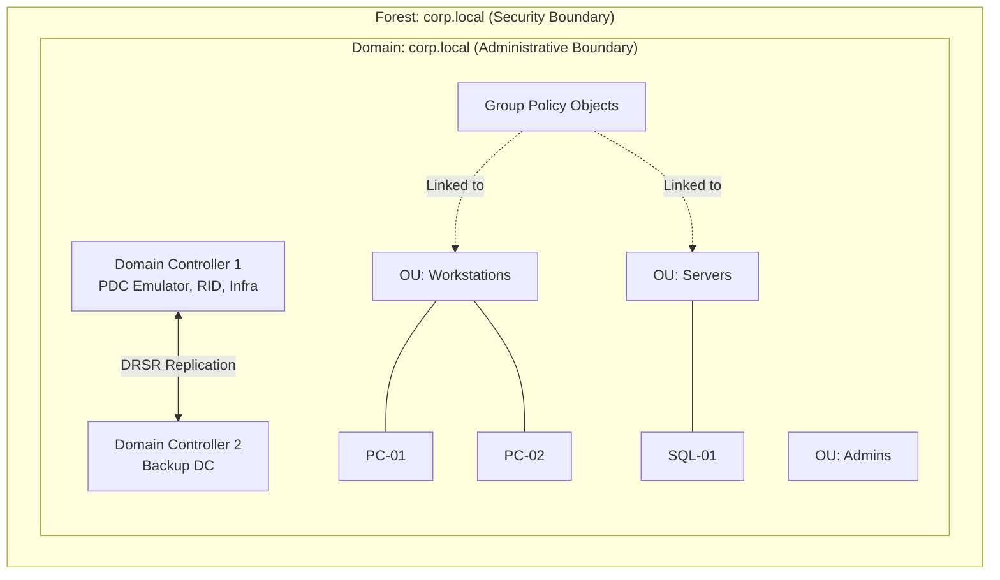

# Module 1: Active Directory Architecture & Foundations

## 1. What to Learn
* **Forests, Trees, and Domains**: Understand the administrative and security boundaries within an organization.
* **Domain Controllers (DCs)**: The servers hosting Active Directory Domain Services (AD DS).
* **FSMO Roles (Flexible Single Master Operations)**: The five special roles distributed across DCs:
  1. *Schema Master* (Forest-wide)
  2. *Domain Naming Master* (Forest-wide)
  3. *PDC Emulator* (Domain-wide - critical for password updates and time synchronization)
  4. *RID Master* (Domain-wide - allocates Relative IDs for SIDs)
  5. *Infrastructure Master* (Domain-wide - cross-domain object references)
* **Active Directory Schema & Objects**: How users, computers, groups, OUs (Organizational Units), and GPOs are defined and stored in the `ntds.dit` database.
* **LDAP & DNS**:
  * LDAP (Lightweight Directory Access Protocol, ports 389/636): Querying and modifying directory objects.
  * DNS (Port 53): SRV records enabling workstations to locate DCs (`_ldap._tcp.dc._msdcs.<domain>`).

## 2. Why You Must Learn It
Without a firm grasp of the object hierarchy:
- You cannot conceptualize where security boundaries actually exist (a Domain is an administrative boundary; the **Forest** is the true security boundary).
- You cannot understand how GPOs push configurations to thousands of endpoints.
- You will fail to understand how the directory database (`ntds.dit`) stores credential hashes and object metadata.

## 3. Core Architecture Diagram



## 4. Key Hands-on Discovery Commands
When connected as a standard authenticated domain user:
```powershell
# Identify current domain and forest functional level
[System.DirectoryServices.ActiveDirectory.Domain]::GetCurrentDomain()

# Locate Domain Controllers and PDC Emulator
nltest /dclist:corp.local
netdom query fsmo

# Query domain workstations and users via LDAP
net user /domain
net group "Domain Admins" /domain
```

## 5. Defensive Best Practices
* **PDC Synchronization**: Enforce NTP time sync across all DCs to prevent Kerberos clock skew errors (default tolerance: 5 minutes).
* **OU Structure**: Structure OUs logically based on security tiers (Tier 0, Tier 1, Tier 2) rather than organizational departments.
