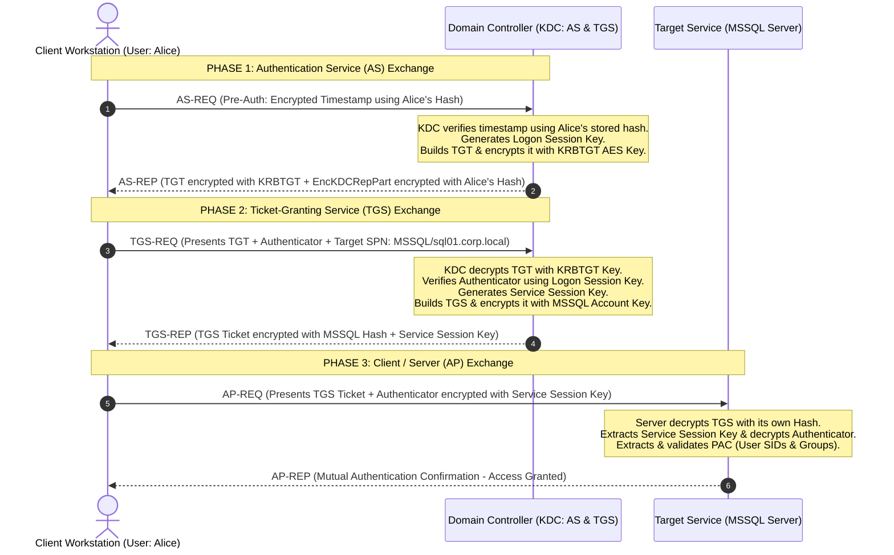

# Module 02: Authentication Protocols — NTLM vs Kerberos RFC 4120 Deep Dive

> **Navigation**: [⬅️ Module 01: AD Architecture & Foundations](Module-01-Active-Directory-Architecture-and-Core-Foundations.md) | [🏠 Master Index](../README.md) | [Module 03: Network Poisoning ➡️](Module-03-Network-Poisoning-and-Credential-Access.md)

---


## 1. NTLM Protocol Architecture & Challenge-Response Mechanics

The NT LAN Manager (NTLM) authentication suite is a suite of cryptographic protocols designed by Microsoft for user authentication and session negotiation. While deprecated in favor of Kerberos, NTLM remains ubiquitous in Active Directory environments for legacy compatibility, workgroups, IP-based access, and cross-forest scenarios.

```
+-----------------------------------------------------------------------------------------+
| NTLMv2 3-WAY CHALLENGE-RESPONSE AUTHENTICATION HANDSHAKE                                |
|                                                                                         |
|  CLIENT WORKSTATION                                  TARGET SERVER (e.g. SMB / IIS)     |
|  +--------------------+                              +--------------------+             |
|  | User: John         |                              | Service: FileShare |             |
|  | NT Hash: 16-byte   |                              |                    |             |
|  +---------+----------+                              +---------+----------+             |
|            |                                                   |                        |
|            | 1. NEGOTIATE_MESSAGE (Type 1)                     |                        |
|            |    * Client capabilities, flags (NTLMv2, Unicode) |                        |
|            |    * Workstation name and Domain name             |                        |
|            +-------------------------------------------------->|                        |
|                                                                |                        |
|                                                                | Server generates       |
|                                                                | 8-byte random Server   |
|                                                                | Challenge (Nonce)      |
|                                                                |                        |
|            | 2. CHALLENGE_MESSAGE (Type 2)                     |                        |
|            |    * 8-byte Server Challenge                      |                        |
|            |    * Target Name (Domain/Server FQDN)             |                        |
|            |    * Target Information Block (AV_PAIRS: DNS name)|                        |
|            |<--------------------------------------------------+                        |
|                                                                                         |
| Client generates 8-byte Client Nonce                                                    |
| Builds Variable-Length Blob (Timestamp + Nonce + Target Info)                           |
| Computes NTLMv2 Response (See Cryptographic Formulas below)                             |
|                                                                                         |
|            | 3. AUTHENTICATE_MESSAGE (Type 3)                                           |
|            |    * Domain Name, User Name, Workstation Name                              |
|            |    * NTLMv2 Response (HMAC Proof + Blob)                                   |
|            |    * LMv2 Response (Optional)                                              |
|            |    * Encrypted Session Key (Optional)                                      |
|            +-------------------------------------------------->|                        |
|                                                                |                        |
|                                                                | Forwards to DC via     |
|                                                                | Netlogon (Pass-Through |
|                                                                | Authentication)        |
+----------------------------------------------------------------+------------------------+
```

### The Cryptographic Formulas of NTLMv2
1. **NT Hash**:
   $$\text{NT Hash} = \text{MD4}(\text{UTF-16LE}(\text{Password}))$$
2. **NTLMv2 Hash (User Key)**:
   $$\text{NTLMv2 Hash} = \text{HMAC-MD5}(\text{NT Hash}, \text{UTF-16LE}(\text{Uppercase}(\text{Username}) + \text{TargetDomain}))$$
3. **Blob Structure**:
   $$\text{Blob} = \text{Header} + \text{Timestamp} + \text{ClientNonce} + \text{AV\_PAIRS} + \text{Reserved}$$
4. **NTLMv2 Response**:
   $$\text{Proof} = \text{HMAC-MD5}(\text{NTLMv2 Hash}, \text{ServerChallenge} + \text{Blob})$$
   $$\text{NTLMv2 Response} = \text{Proof} + \text{Blob}$$

---

### NetNTLM Hash vs. NT Hash: Why NetNTLM Cannot Be "Passed"
A frequent source of operator confusion is the difference between an **NT Hash** and a **NetNTLM Hash**:

| Property | NT Hash (NTLM Hash) | NetNTLM Hash (NetNTLMv1 / NetNTLMv2) |
| :--- | :--- | :--- |
| **Where it lives** | Stored in `ntds.dit` (DC) or SAM registry / LSASS memory (workstations). | Generated on the wire during network authentication. Captured by Responder or Inveigh. |
| **Length & Format** | Fixed 16 bytes (32 hex characters): `e5fc4f2b49d70367b54da724e1185ac4` | Variable string: `admin::CORP:1122334455667788:A9C8...:01010...` |
| **Pass-the-Hash (PTH)**| **YES**. Can be directly fed into tools (`psexec`, `wmiexec`, `smbclient`) to authenticate. | **NO**. Cannot be passed to authenticate because it is the product of a one-time challenge. |
| **Weaponization** | Immediate lateral movement and ticket requests. | Must be cracked offline (Hashcat mode 5600) OR relayed in real time to another server! |

---

## 2. Kerberos Protocol Architecture (RFC 4120)

Kerberos is a ticket-based, symmetric-key authentication protocol designed to eliminate the transmission of password hashes over the network. In an Active Directory domain, every Domain Controller operates a **Key Distribution Center (KDC)** listening on UDP/TCP port 88.



---

## 3. Microscopic Breakdown of the 3-Way Exchange

### Phase 1: Authentication Service Exchange (AS-REQ / AS-REP)
1. **AS-REQ**:
   * The client initiates authentication. It constructs a `PA-ENC-TIMESTAMP` (Pre-Authentication Encrypted Timestamp) encrypted with a key derived from the user's password (via PBKDF2 string-to-key for AES, or MD4 for RC4).
   * It sends the user name (`cname`), domain realm, and a list of supported encryption types.
2. **AS-REP**:
   * The KDC decrypts the timestamp using the user's secret key stored in `ntds.dit`. If the decrypted timestamp is within **5 minutes** of the DC's clock, pre-authentication succeeds.
   * The KDC generates a random **Logon Session Key** ($K_{\text{Session}}$).
   * The KDC constructs the **Ticket Granting Ticket (TGT)**:
     ```
     TGT = Encrypted_with_KRBTGT_Key(
             Client Name: Alice,
             Logon Session Key: K_Session,
             Validity Window: StartTime, EndTime, RenewTill,
             Privilege Attribute Certificate: PAC (SIDs, Groups)
           )
     ```
   * The KDC returns the TGT alongside `EncKDCRepPart` (which contains $K_{\text{Session}}$ encrypted with Alice's key). Alice decrypts this packet to obtain $K_{\text{Session}}$, while the TGT remains an opaque encrypted blob.

---

### Phase 2: Ticket Granting Service Exchange (TGS-REQ / TGS-REP)
1. **TGS-REQ**:
   * Alice wishes to access an application service (e.g., `cifs/fileserver.corp.local`).
   * Alice cannot access the service using her TGT directly. She sends a request to the KDC's TGS service containing:
     1. The **TGT** (encrypted with `krbtgt`).
     2. An **Authenticator**: Alice's username and current timestamp encrypted with $K_{\text{Session}}$ (proves Alice holds the session key).
     3. The requested **Service Principal Name (SPN)**: `cifs/fileserver.corp.local`.
2. **TGS-REP**:
   * The KDC decrypts the TGT using its own `krbtgt` key.
   * The KDC extracts $K_{\text{Session}}$ from the TGT and decrypts Alice's Authenticator.
   * The KDC looks up the SPN in Active Directory to find which account runs the service (e.g., machine account `FILESERVER$` or service account `svc_cifs`).
   * The KDC generates a **Service Session Key** ($K_{\text{Service}}$).
   * The KDC copies the PAC from the TGT into a new ticket, and encrypts the new ticket with the **Target Service Account's Password Hash**:
     ```
     TGS (Service Ticket) = Encrypted_with_Service_Key(
                              Client Name: Alice,
                              Service Session Key: K_Service,
                              Validity Window,
                              PAC (Privilege Attribute Certificate)
                            )
     ```
   * The KDC sends the TGS to Alice, along with $K_{\text{Service}}$ encrypted with $K_{\text{Session}}$.

---

### Phase 3: Client/Server Exchange (AP-REQ / AP-REP)
1. **AP-REQ**:
   * Alice contacts the file server directly on port 445. She transmits:
     1. The **TGS Ticket** (encrypted with the service's key).
     2. An **Authenticator** encrypted with $K_{\text{Service}}$.
2. **AP-REP**:
   * The file server decrypts the TGS ticket using its own local password hash / machine key.
   * It extracts $K_{\text{Service}}$ and decrypts Alice's Authenticator to ensure timestamps match.
   * It inspects Alice's PAC to identify her group memberships (e.g., Domain Admins, Accounting Users) and checks local NTFS DACLs.
   * The server optionally replies with `AP-REP` to prove mutual authentication.

---

## 4. The Privilege Attribute Certificate (PAC) Internals

The **Privilege Attribute Certificate (PAC)** is an extension to Kerberos tickets introduced by Microsoft (MS-PAC) to transport Windows authorization data (SIDs, privileges, group memberships) inside Kerberos tickets.

```
+-----------------------------------------------------------------------------+
| STRUCTURE OF THE PRIVILEGE ATTRIBUTE CERTIFICATE (MS-PAC)                   |
|                                                                             |
|  1. LOGON_INFO (PAC_INFO_BUFFER Type 0x00000001)                            |
|     * User SID (e.g. S-1-5-21-3914...-1104)                                |
|     * Primary Group SID (e.g. Domain Users - RID 513)                       |
|     * Group SIDs: Array of all Security Groups user belongs to              |
|     * UserAccountControl Flags & Password Expiration Timestamps             |
|                                                                             |
|  2. PAC_SERVER_CHECKSUM (Type 0x00000006)                                   |
|     * Cryptographic HMAC signature over LOGON_INFO                          |
|     * Keyed with: TARGET SERVICE ACCOUNT'S SECRET KEY                       |
|     * Proves: The service ticket was issued for this specific service.      |
|                                                                             |
|  3. PAC_PRIVSVR_CHECKSUM (KDC Checksum - Type 0x00000007)                   |
|     * Cryptographic HMAC signature over the PAC_SERVER_CHECKSUM             |
|     * Keyed with: DOMAIN CONTROLLER'S KRBTGT SECRET KEY                     |
|     * Proves: The KDC itself authorized and generated this PAC.             |
|                                                                             |
|  4. PAC_CLIENT_INFO (Type 0x0000000A)                                       |
|     * Client ID, Client Name (UTF-16), and Timestamp                        |
+-----------------------------------------------------------------------------+
```

### PAC Validation Mechanics
When an application server receives a TGS, how does it know the client didn't forge the group SIDs inside the PAC?
1. The application server decrypts the TGS using its own password hash and verifies the `PAC_SERVER_CHECKSUM`.
2. However, the server does not have the `krbtgt` key to verify the `PAC_PRIVSVR_CHECKSUM`.
3. In high-security configurations, the server performs **PAC Validation**: It sends an RPC request via Netlogon (`NetrLogonSamLogonWithFlags`) to the Domain Controller asking: *"Did you issue this PAC with this KDC checksum for user Alice?"* The DC verifies its signature and responds with success.

> [!CAUTION]
> **CVE-2014-6324 (MS14-068)**: The Windows KDC failed to properly validate the signature algorithm type in PAC checksums. Attackers could forge a PAC claiming Domain Admin membership, calculate an MD5 signature without any key, and the KDC accepted it, issuing a valid Domain Admin TGT from an unprivileged account!

---

## 5. Kerberos Encryption Types & The Downgrade Attack Surface

The Kerberos protocol supports multiple symmetric encryption algorithms negotiated during the AS-REQ and TGS-REQ exchanges:

| Etype (Hex) | Etype (Decimal) | Algorithm Name | Security Status & Attack Vector |
| :--- | :--- | :--- | :--- |
| `0x1` / `0x3` | 1 / 3 | `des-cbc-crc` / `des-cbc-md5` | **Broken**. Deprecated since Windows 7 / Server 2008 R2. Easily brute-forced in hours. |
| `0x17` | **23** | **`rc4-hmac`** | **Vulnerable**. Key is directly derived from the raw NT hash (MD4). No salt, no iteration rounds. Target of **Kerberoasting** downgrade attacks! |
| `0x11` | 17 | `aes128-cts-hmac-sha1-96` | Strong. Key derived via PBKDF2 (4,096 iterations + domain/username salt). |
| `0x12` | 18 | `aes256-cts-hmac-sha1-96` | **Enterprise Standard**. Modern secure baseline. Highly resistant to offline cracking. |

### The RC4 Downgrade Vector in Kerberoasting:
Even if a domain operates at Windows Server 2022 functional level with AES enabled, most Active Directory service accounts still retain their RC4-HMAC keys in `ntds.dit` for backward compatibility. 
When an attacker crafts a `TGS-REQ` specifying only `etype 23 (rc4-hmac)` in the requested encryption types list, the KDC obliges and encrypts the resulting TGS ticket using the service account's **NT Hash** instead of its AES key. This allows the attacker to crack the ticket using Hashcat at billions of hashes per second, compared to a few thousand hashes per second for AES-256!

---

## 6. Kerberos Clock Skew & Replay Cache Defense

Kerberos is strictly time-dependent to prevent replay attacks without requiring servers to store indefinite session histories.

### The 5-Minute Tolerance Rule
The KDC and all domain member computers enforce a default maximum **Clock Skew of 5 minutes** (300 seconds), controlled by the Group Policy setting:
`Computer Configuration -> Windows Settings -> Security Settings -> Account Policies -> Kerberos Policy -> Maximum tolerance for computer clock synchronization`.

```
If | Client_Timestamp - Server_Timestamp | > 300 seconds:
    Authentication Fails with error: KRB_AP_ERR_SKEW (0x25 / KDC_ERR_SKEW)
```

### The Replay Cache
To defeat adversaries who intercept an `AP-REQ` packet and replay it within the valid 5-minute window, application servers maintain an in-memory **Replay Cache**:
* The server records the `(Client Name, Microsecond Timestamp)` of every accepted Authenticator.
* If a duplicate Authenticator arrives with the exact same timestamp within the 5-minute window, it is instantly dropped and logged as a replay attack.


---

> **Navigation**: [⬅️ Module 01: AD Architecture & Foundations](Module-01-Active-Directory-Architecture-and-Core-Foundations.md) | [🏠 Master Index](../README.md) | [Module 03: Network Poisoning ➡️](Module-03-Network-Poisoning-and-Credential-Access.md)
