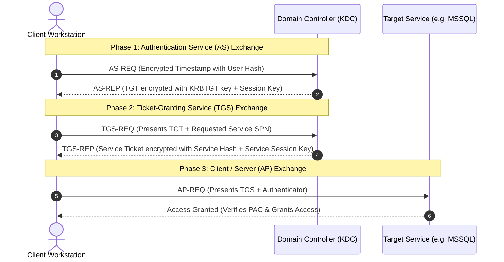

# Module 2: Authentication Protocols — Kerberos vs NTLM

## 1. What to Learn
* **NTLMv2 Authentication & NetNTLM Hashes**:
  * Challenge-response protocol using MD4 hashes.
  * Why NTLM is vulnerable to relay attacks (lack of mutual authentication and session binding).
* **Kerberos 3-Way Handshake**:
  1. **AS-REQ / AS-REP**:
     * Client encrypts a timestamp with its password hash (pre-authentication).
     * Key Distribution Center (KDC) verifies timestamp and issues a **TGT (Ticket Granting Ticket)** encrypted with the `krbtgt` account hash, plus a logon session key.
  2. **TGS-REQ / TGS-REP**:
     * Client presents TGT and requests access to a target service via its **SPN (Service Principal Name)**.
     * KDC issues a **TGS (Service Ticket)** encrypted with the target service account's password hash.
  3. **AP-REQ / AP-REP**:
     * Client presents TGS to the application server (e.g., MSSQL, SMB, HTTP).
     * Server decrypts TGS using its own secret key and verifies the user identity.
* **PAC (Privilege Attribute Certificate)**:
  * Embedded inside the ticket by the KDC; lists the user's SID, group SIDs, and privileges.
  * Signed with the KDC key and server key to prevent tampering.

## 2. Why You Must Learn It
Kerberos is the foundational security protocol of modern Active Directory. Every major enterprise attack vector exploits a specific stage of this exchange:
- **AS-REP Roasting**: Exploits users with "Do not require Kerberos preauthentication" enabled.
- **Kerberoasting**: Exploits normal users requesting a TGS for service accounts, then cracking the service hash offline.
- **Silver Ticket**: Forges an AP-REQ service ticket using a cracked service account hash.
- **Golden Ticket**: Forges a complete TGT using the domain's master `krbtgt` hash.

## 3. Protocol Exchange Flowchart

## 4. Key Security Takeaways
* Standard Kerberos traffic runs over **TCP/UDP port 88**.
* NTLM authentication should be audited and restricted using Group Policy (`Network security: Restrict NTLM: Outgoing traffic to remote servers`).
* Passwords for service accounts must exceed 25 characters to resist offline Kerberoasting brute-force attacks.
