# Module 3: Active Directory Enumeration & Attack Graph Theory

## 1. What to Learn
* **Directory Enumeration Techniques**:
  * **LDAP Search Filters**: Querying users, groups, computer objects, and description fields using standard LDAP queries over port 389/636.
  * **PowerView / ActiveDirectory PowerShell Module**: Navigating administrative groups, domain trusts, and unconstrained delegation.
  * **RPC & SMB Enumeration**: Finding local administrator sessions, logged-on users, and accessible network shares (SYSVOL, NETLOGON).
* **Graph Theory & BloodHound / SharpHound**:
  * Why attackers think in graphs while defenders think in lists.
  * Nodes (Users, Computers, Groups, OUs, Domains, GPOs) and Edges (MemberOf, AdminTo, HasSession, GenericAll, WriteDacl, CanRDP).
  * Finding the **Shortest Path to Domain Admin (Tier 0)**.

## 2. Why You Must Learn It
90% of Active Directory compromises do not rely on zero-day software exploits. They exploit **derivative relationships** and configuration drift:
- A helpdesk user is a local admin on Workstation A.
- A Domain Admin logged into Workstation A two hours ago (leaving credential material in LSASS memory).
- Compromising Workstation A leads directly to Domain Admin in 2 hops.

## 3. Attack Graph Visualization

```mermaid
graph LR
    U["Compromised User: jsmith<br/>(Standard Domain User)"]
    G1["Group: IT Support Tier 1"]
    W1["Workstation: PC-IT04"]
    SESS["Active LSASS Session:<br/>DA Admin_Bob"]
    DA["Group: Domain Admins"]
    DC["Domain Controller (Tier 0)"]

    U -->|MemberOf| G1
    G1 -->|AdminTo| W1
    W1 -.->|Contains Session| SESS
    SESS -->|MemberOf| DA
    DA -->|Full Control| DC

    style U fill:#f96,stroke:#333,stroke-width:2px
    style DA fill:#f66,stroke:#333,stroke-width:2px
    style DC fill:#f00,stroke:#333,stroke-width:3px
```



## 4. Enumeration Concepts & Queries
```powershell
# Query domain users with SPNs set (potential Kerberoasting targets)
Get-DomainUser -SPN

# Query domain users with pre-authentication disabled
Get-DomainUser -PreauthNotRequired

# Query ACL permissions over high-value groups
Get-DomainObjectAcl -Identity "Domain Admins" -ResolveGUIDs
```

## 5. Defensive Detection Strategies
* **SharpHound Detection**: Monitor for mass LDAP queries hitting the DC within a short time window (Event ID 4662 / Sysmon Event ID 3).
* **RPC Endpoint Filtering**: Block remote SAMR and MSRPC calls from standard user workstations to limit session enumeration.
