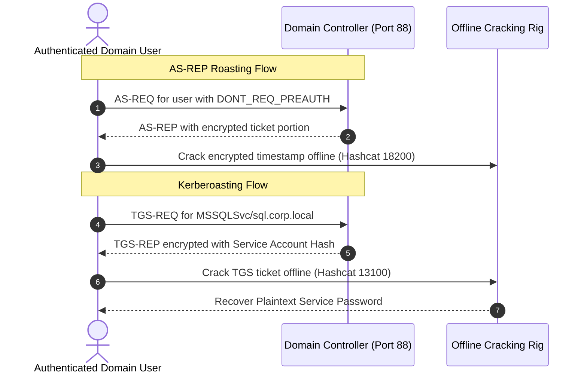

# Module 4: Credential Attacks & Kerberos Delegation

## 1. What to Learn
* **AS-REP Roasting**:
  * Exploits user accounts configured with `DONT_REQ_PREAUTH` (UserAccountControl bitmask).
  * Any user can request an AS-REP ticket for that target without knowing their password, and crack the encrypted timestamp offline with Hashcat (mode 18200).
* **Kerberoasting**:
  * Exploits Service Principal Names (SPNs) associated with user accounts.
  * Any authenticated domain user can request a TGS ticket for that service from the DC.
  * The ticket is encrypted with the service account's NTLM hash; extracting and cracking it offline (Hashcat mode 13100) reveals the plaintext password.
* **Kerberos Delegation Mechanics**:
  * **Unconstrained Delegation**: The server caches the user's complete TGT in LSASS memory; compromising this server allows impersonating any user who connects.
  * **Constrained Delegation (S4U2Self & S4U2Proxy)**: Allows a service to request a ticket on behalf of any user to a specific set of target services.
  * **Resource-Based Constrained Delegation (RBCD)**: The target computer object defines who can delegate to it via the `msDS-AllowedToActOnBehalfOfOtherIdentity` attribute.

## 2. Why You Must Learn It
Kerberoasting and delegation attacks are among the most pervasive vectors in enterprise breaches because:
- They exploit normal, intended Kerberos functionality rather than coding bugs.
- They generate minimal abnormal network noise (standard port 88 Kerberos ticket requests).
- Service accounts frequently possess high privileges (Local Administrator on database servers or even Domain Admin).

## 3. Attack Progression Diagram

## 4. Key Defensive Mitigations
* **Group Managed Service Accounts (gMSA)**: Migrate all service accounts to gMSAs with 120-character random passwords rotated automatically by Active Directory.
* **Enforce Kerberos AES**: Disable legacy RC4 encryption for Kerberos tickets to force AES-128/AES-256, rendering offline cracking significantly slower.
* **Audit Pre-Authentication**: Never enable `DONT_REQ_PREAUTH` on active user accounts.
* **Protected Users Group**: Place high-privilege administrative accounts into the **Protected Users** security group (disables NTLM, prevents delegation, and restricts ticket caching).
