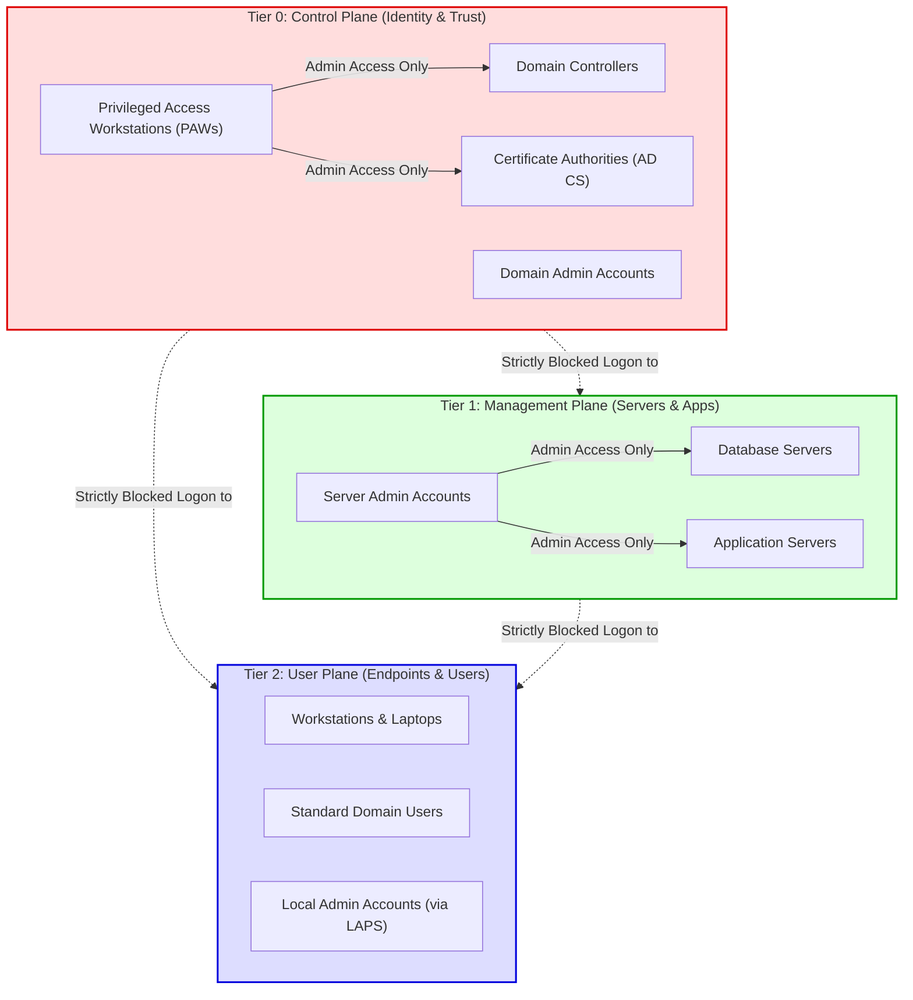

# Module 6: Enterprise Defense, Detection Engineering & Tiering

## 1. What to Learn
* **Microsoft Tiered Administrative Model (Tier 0 / Tier 1 / Tier 2)**:
  * **Tier 0 (Control Plane)**: Domain Controllers, PKI, ADFS, Azure AD Connect, Domain Admins. Credentials at Tier 0 must NEVER touch lower tiers.
  * **Tier 1 (Server Plane)**: Enterprise application servers, database servers, file servers, Server Admins.
  * **Tier 2 (Workstation Plane)**: End-user PCs, laptops, mobile devices, Workstation Admins.
* **Privileged Access Workstations (PAWs)**:
  * Dedicated, hardened physical hardware used exclusively for managing Tier 0 assets.
* **Critical Windows Event IDs for AD Monitoring**:
  * `Event ID 4624`: Successful account logon (logon type 3 = network, type 10 = RDP).
  * `Event ID 4625`: Failed logon attempt (essential for detecting password spraying and brute force).
  * `Event ID 4768`: Kerberos TGT requested (AS-REQ).
  * `Event ID 4769`: Kerberos Service Ticket requested (look for RC4 downgrade `0x17` indicating Kerberoasting).
  * `Event ID 4771`: Kerberos pre-authentication failed (look for AS-REP roasting).
  * `Event ID 4662`: Directory Service Access (DCSync replication monitoring).
  * `Event ID 4720`: New user account created.
  * `Event ID 4728`: Member added to security-enabled global group (e.g. Domain Admins).
  * `Event ID 4738`: User account modified (e.g. SPN added or pre-auth disabled).

## 2. Why You Must Learn It
Building defenses is the true measure of mastery in cybersecurity. Knowing how an attacker moves allows you to:
- Design architectures where credential theft on a workstation cannot compromise a Domain Controller.
- Write high-fidelity SIEM / Sigma detection rules that alert your SOC in real time.
- Conduct thorough post-incident recovery without having to rebuild the entire enterprise domain.

## 3. Microsoft Enterprise Access Model Architecture

## 4. Hardening Checklist
1. **Enable LAPS (Local Administrator Password Solution)**: Eliminate static, shared local administrator passwords across workstations.
2. **Implement Protected Users Security Group**: Place all Domain Admins and Enterprise Admins inside `Protected Users` to prevent credential caching in LSASS and disable NTLM.
3. **Enforce Kerberos Armoring (FAST)**: Prevent pre-authentication spoofing and dictionary attacks against AS-REQ exchanges.
4. **Deploy Honeytokens & Decoy Accounts**: Create dummy accounts with SPNs set (`spn_sql_admin`) that alert the SOC whenever queried.
5. **Enforce SMB Signing & LDAP Signing**: Prevent NTLM relay attacks by requiring cryptographic signing on all SMB and LDAP traffic across the domain.
