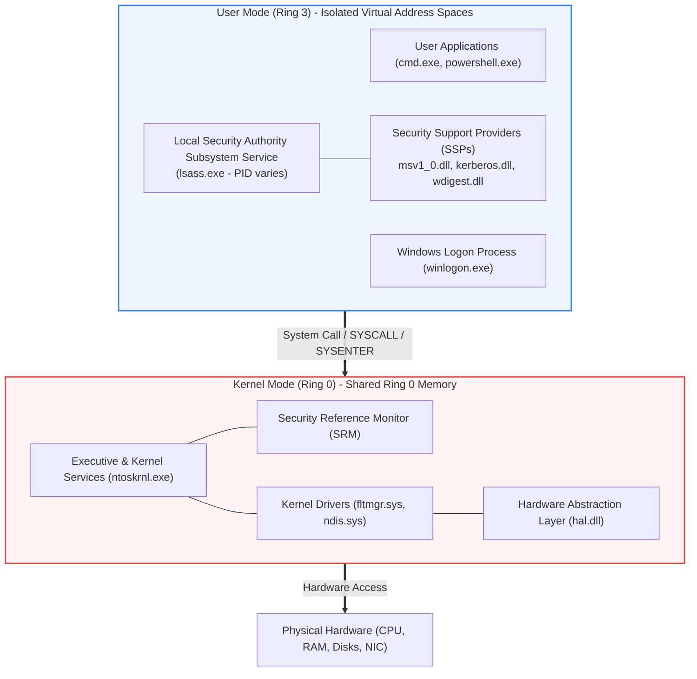

# Module 9: Windows Internals, File Systems & Memory Architecture

> **Target Audience**: Security engineers, reverse engineers, and penetration testers seeking deep, low-level mastery of Windows operating system internals, memory structures, and NTFS architecture.

---

## 🧭 Windows Architectural Layers



---

## 1. Windows Memory Architecture: From Pages to LSASS

### 1.1 User Mode (Ring 3) vs. Kernel Mode (Ring 0)
Windows utilizes the x86/x64 hardware privilege rings to enforce process security:
* **User Mode (Ring 3)**:
  * Applications execute with restricted CPU instructions.
  * Each process operates in its own **isolated private Virtual Address Space (VAS)** (typically 128 TB on 64-bit Windows).
  * A crash or segmentation fault in one user-mode process cannot crash other applications or the operating system.
  * Direct access to physical memory, hardware I/O ports, or disk controllers is strictly forbidden.
* **Kernel Mode (Ring 0)**:
  * Operating system core components (`ntoskrnl.exe`), drivers, and the **Security Reference Monitor (SRM)** execute with unrestricted CPU privileges.
  * All kernel components share a single, unified address space. A single bug or unhandled memory fault in a third-party kernel driver results in a Blue Screen of Death (BSOD / BugCheck).

### 1.2 Process Anatomy: EPROCESS, PEB, and TEB
When Windows launches an executable, the kernel creates structural representations in memory:
1. **`EPROCESS` (Executive Process Block)**:
   * A kernel-mode data structure containing process identification (PID), directory table base (CR3 register / Page Directory Base), token pointer, and security descriptors.
2. **`PEB` (Process Environment Block)**:
   * A user-mode structure mapped into the process address space.
   * Contains loaded DLL lists (`InLoadOrderModuleList`), image base address, command-line arguments, environment variables, and heap pointers.
   * *Security Relevance*: EDR hooks inspect the PEB; malware often unhooks DLLs by parsing the PEB directly without calling Windows APIs.
3. **`TEB` (Thread Environment Block)**:
   * Stores per-thread state, stack base/limit, thread-local storage (TLS), and the LastError value.

### 1.3 LSASS Memory Architecture & SSP Packages
The **Local Security Authority Subsystem Service (`lsass.exe`)** manages user authentication, access token creation, and password validation on Windows:
* Inside `lsass.exe`, Windows loads multiple **Security Support Providers (SSPs)** as Dynamic Link Libraries (DLLs):
  * **`msv1_0.dll`**: Handles NTLM authentication and caches NTLM hashes for active sessions.
  * **`kerberos.dll`**: Implements the Kerberos protocol, maintaining cached TGTs, TGS service tickets, and session keys.
  * **`wdigest.dll`**: Implements HTTP Digest authentication (traditionally cached cleartext passwords in memory prior to Windows 8.1).
  * **`tspkg.dll`**: Terminal Services Package for CredSSP (RDP authentication).
* **The LSASS Extraction Mechanism (Mimikatz)**:
  * Mimikatz opens a handle to `lsass.exe` using `OpenProcess(PROCESS_VM_READ | PROCESS_QUERY_INFORMATION)`.
  * It locates the internal exported symbols and global tables (e.g. `LogonSessionList`).
  * It parses the internal linked lists to extract cached hashes, Kerberos tickets, and plaintext passwords directly from RAM.

---

## 2. Advanced Memory Defenses & Bypasses

### 2.1 LSA Protection (`RunAsPPL`)
* **What it does**: Configures `lsass.exe` as a **Protected Process Light (PPL)**.
* **Registry Setting**:
  ```reg
  [HKLM\SYSTEM\CurrentControlSet\Control\Lsa]
  "RunAsPPL"=dword:00000001
  ```
* **Enforcement Mechanism**: The Windows kernel SRM intercepts all `OpenProcess` calls to `lsass.exe`. If the requesting process is not digitally signed with a specialized Microsoft Certificate Authority, the kernel immediately denies the handle with `STATUS_ACCESS_DENIED`.
* **Field Bypass (Bring Your Own Vulnerable Driver - BYOVD)**:
  * Because PPL is enforced by the kernel, an administrator can drop a legitimately code-signed, vulnerable third-party driver (e.g. `RTCore64.sys` or Process Hacker's `kprocesshacker.sys`).
  * The attacker leverages arbitrary kernel read/write primitives in the driver to locate the `EPROCESS` block for `lsass.exe` and toggle the `Protection` byte (`_PS_PROTECTION`) from PPL to 0, completely disabling LSA Protection in memory without a reboot.

### 2.2 Windows Credential Guard (Virtualization-Based Security / VBS)
* **Architecture**: Leverages Microsoft Hyper-V to create an isolated hardware security enclave termed **Virtual Secure Mode (VSM)**.
* **How it operates**:
  * The actual Kerberos keys and NTLM hash secrets are stripped from `lsass.exe` and moved into an isolated virtual machine process named **`LsaIso.exe`** (Isolated LSA).
  * When `lsass.exe` needs to decrypt a ticket or sign a challenge, it makes an RPC call to `LsaIso.exe` across the hypervisor boundary.
* **Security Impact**: Even an attacker with full `NT AUTHORITY\SYSTEM` or arbitrary Ring 0 kernel execution cannot read the memory of `LsaIso.exe`. Mimikatz fails with `Empty / Virtualized Credential`.

---

## 3. Windows File Systems: NTFS Deep-Dive

### 3.1 NTFS Architecture & Security Descriptors
NTFS organizes security via the **Master File Table (MFT)** where every file record contains attributes:
* **`$STANDARD_INFORMATION`**: Timestamps, read-only/hidden flags.
* **`$FILE_NAME`**: File names (both long and DOS 8.3 formats).
* **`$DATA`**: The raw file contents.
* **`$SECURITY_DESCRIPTOR`**:
  * **Owner SID**: The principal who owns the file.
  * **Group SID**: Primary group.
  * **DACL (Discretionary Access Control List)**: Explicit rules granting or denying read/write/execute rights (`ALLOW` / `DENY` ACEs).
  * **SACL (System Access Control List)**: Auditing rules that generate Windows Security Event logs when a file is touched.

### 3.2 NTFS Alternate Data Streams (ADS)
NTFS supports multiple data streams attached to a single file name. The default unnamed stream is accessible as `file.txt`. An additional named stream can be appended using a colon (`:`):
```cmd
# Write hidden executable payload into an existing text file's alternate stream
type payload.exe > readme.txt:hidden_payload.exe

# The file size of readme.txt appears completely unchanged in Windows Explorer!
# Execute the hidden stream using WMIC or PowerShell
wmic process call create "C:\path\readme.txt:hidden_payload.exe"
```
* **Mark-of-the-Web (MOTW)**: When a file is downloaded from the Internet, Windows automatically writes an Alternate Data Stream named `file.pdf:Zone.Identifier` containing `ZoneId=3` (Internet). This triggers SmartScreen and Protected View warnings.

### 3.3 Volume Shadow Copies (VSS) & Extracting `ntds.dit`
When Windows Server runs as a Domain Controller, the directory database (`C:\Windows\NTDS\ntds.dit`) is locked exclusively by the operating system kernel with an exclusive read/write lock. Attempting to copy it via `copy` or `xcopy` fails with `The process cannot access the file because it is being used by another process`.

* **How Pentesters & Administrators Bypass the Lock**:
  Volume Shadow Copy Service (VSS) creates a point-in-time snapshot of the volume, capturing block-level data without interrupting the running database:
  ```cmd
  # Create a volume shadow copy of drive C:
  vssadmin create shadow /for=C:

  # Copy the locked NTDS.dit and SYSTEM hive from the shadow copy
  copy \\?\GLOBALROOT\Device\HarddiskVolumeShadowCopy1\Windows\NTDS\ntds.dit C:\temp\ntds.dit
  copy \\?\GLOBALROOT\Device\HarddiskVolumeShadowCopy1\Windows\System32\config\SYSTEM C:\temp\SYSTEM
  ```
  The `SYSTEM` hive contains the BootKey (SysKey) required to decrypt the password hashes inside `ntds.dit`.

---

## 4. Operational Troubleshooting & Behavioral Scenarios

### 4.1 Restricted Admin Mode for RDP (`/restrictedadmin`)
* **Problem**: When a Domain Administrator connects via Remote Desktop (RDP) to a compromised server, their credentials/tokens are left in the server's LSASS memory.
* **Solution**: Enable **Restricted Admin Mode**:
  ```cmd
  mstsc.exe /v:target_server /restrictedadmin
  ```
* **How it behaves**: The client authenticates using network authentication (Kerberos/NTLM) without sending plaintext credentials or delegating reusable tokens. If an attacker dumps LSASS on the target server, no Domain Admin credentials exist in memory.

### 4.2 Overcoming Network RPC Filtering & Endpoint Isolation
* When Windows Defender or host firewalls block inbound MSRPC (Port 135) or SMB (Port 445):
  * **WinRM (Port 5985/5986)**: Frequently permitted for DevOps and management.
  * **SSH for Windows (Port 22)**: Built-in to modern Windows Server 2019/2022.
  * **Named Pipe Pivoting via SMB**: If port 445 is allowed between specific hosts, an attacker can tunnel all traffic over a named pipe (`\\.\pipe\msagent_pipe`) rather than opening new firewall ports.
